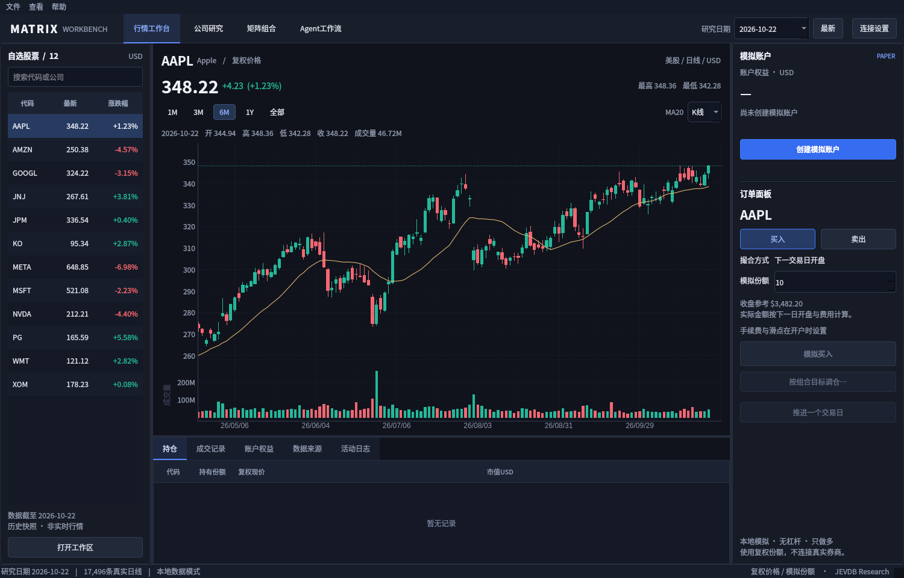

# 矩阵原理及应用课程大作业

本项目选择题目二：基于JEVDB的股票研究与模拟交易软件。

**当前阶段：Windows桌面版。** Qt原生窗口提供自选股、K线、公司研究、矩阵组合和模拟交易。离线关键词模式使用 AND/OR 匹配与 BM25 排序，并明确标记；JEVDB 语义模式需要可用的 Linux 语义服务或模型端点，未配置时会明确报错，不会用关键词结果冒充语义结果。2026-11-25 已用 DeepSeek 兼容端点加本地协议适配层完成 40 条查询（宏 F1 0.865，对照关键词 AND 0.793），验证记录见 [docs/verification/jevdb-smoke-2026-11-25.md](docs/verification/jevdb-smoke-2026-11-25.md)。

**Windows下载：[v0.1.0便携包](https://github.com/mmmsssttt404/matrix/releases/download/v0.1.0/MatrixWorkbench-Windows-x64-v0.1.0.zip)** · [Releases版本页](https://github.com/mmmsssttt404/matrix/releases/latest)

完整解压后双击`MatrixWorkbench.exe`，保留同目录的`_internal`文件夹，无需安装Python。

- [方案简报：范围、软件、存储和验收](docs/proposal.md)
- [Windows启动与使用](docs/windows.md)
- [桌面排布与GitHub代码参考](docs/desktop-design.md)
- [运行说明与演示步骤](docs/runbook.md)
- [项目报告、方法与验证边界](docs/report.md)
- [工具职责、权限与许可](docs/tools.md)
- [人工标注评估集与运行方法](evaluation/README.md)
- [成员贡献记录模板](docs/contributions.md)
- 本地作业要求：`materials/assignment-requirements.pdf`，该目录不提交到公开仓库。

核心流程：用户提出筛选条件→JEVDB查询或明确标记的离线关键词筛选→矩阵方法分析组合风险→模拟下单→展示持仓、净值与可追溯依据。矩阵页包含协方差/收缩、条件数、PCA 解释方差、风险贡献分解、无约束闭式解对照和收缩路径。

```bash
python3 -m venv .venv
.venv/bin/python -m pip install -r requirements-desktop.lock
.venv/bin/python -m matrixlab.cli doctor
.venv/bin/python -m matrixlab.cli fetch
.venv/bin/python -m matrixlab.cli archive --asof 2024-12-31
.venv/bin/python -m matrixlab.desktop
```

上面的源码启动命令用于Linux x86-64、Python3.13。Windows用户解压构建包后运行`MatrixWorkbench.exe`；源码使用`requirements-windows.lock`。下载需要网络，已有本地CSV后数值计算与模拟交易可离线运行。Windows的真实JEVDB查询通过Linux语义服务连接。



源码与项目文档统一维护在`main`分支，Windows可执行包通过GitHub Releases提供；原始数据、密钥和虚拟环境保留本地。`requirements.lock`保存完整实测依赖版本。测试：`.venv/bin/python -m pytest -q`。关键词基线评估：`.venv/bin/python evaluation/evaluate.py --mode keyword --operator all`；JEVDB 与关键词对照：`.venv/bin/python evaluation/evaluate.py --mode both`（需可用端点，见`docs/runbook.md`）。

参考：[JEVDB作者仓库](https://github.com/PDAIS/JEVDB)、[题目对应论文](https://arxiv.org/abs/2610.02046v1)。
