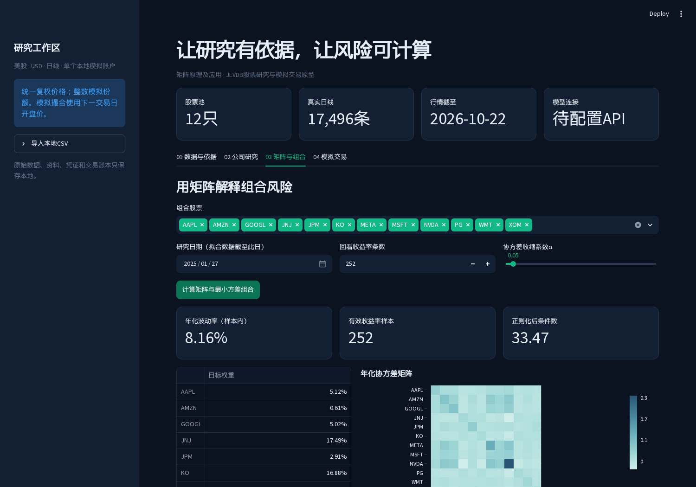

# 矩阵原理及应用课程大作业

本项目选择题目二：基于JEVDB的股票研究与模拟交易软件。

**当前阶段：可运行原型。** 已实现真实行情获取、资料筛选、矩阵风险计算、样本外比较及模拟交易。模型API按用户决定稍后配置；离线关键词结果有独立标识。

- [方案简报：范围、软件、存储和验收](docs/proposal.md)
- [运行说明与演示步骤](docs/runbook.md)
- [项目报告、方法与验证边界](docs/report.md)
- [工具职责、权限与许可](docs/tools.md)
- [成员贡献记录模板](docs/contributions.md)
- 本地作业要求：`materials/assignment-requirements.pdf`，该目录不提交到公开仓库。

核心流程：用户提出筛选条件→JEVDB查询或明确标记的离线关键词筛选→矩阵方法分析组合风险→模拟下单→展示持仓、净值与可追溯依据。

```bash
python3 -m venv .venv
.venv/bin/python -m pip install -r requirements.lock
.venv/bin/python -m matrixlab.cli doctor
.venv/bin/python -m matrixlab.cli fetch
.venv/bin/python -m matrixlab.cli archive --asof 2024-12-31
.venv/bin/streamlit run app.py
```

支持Linux x86-64、Python3.12及以上；当前锁定环境实测为Python3.13。下载需要网络；已有本地CSV后，矩阵分析和模拟交易可离线运行。真实JEVDB语义判断需要模型API凭证。



协作采用功能分支和Pull Request；原始数据、密钥、虚拟环境及大体积产物保留本地。`requirements.lock`保存完整实测依赖版本。测试：`.venv/bin/python -m pytest -q`。

参考：[JEVDB作者仓库](https://github.com/PDAIS/JEVDB)、[题目对应论文](https://arxiv.org/abs/2610.02046v1)。
