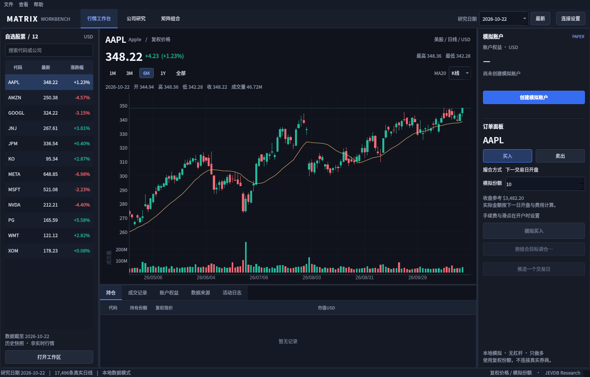

# 桌面版设计与代码参考

本次根据用户提供的原界面截图重做桌面体验。原画面可见的问题是：标题占据大量首屏空间，统计卡片内容被截断，数据质量表取代了行情主画面，研究、选股和下单之间缺少同屏联系。

## 参考与采用方式

| 来源 | 实际检查的内容 | 本项目采用方式 |
|---|---|---|
| [vn.py主窗口](https://github.com/vnpy/vnpy/blob/master/vnpy/trader/ui/mainwindow.py) | `init_dock`的交易、行情、持仓与成交监视器布局；选中行情联动交易控件 | Qt分隔面板、底部交易表格、股票选择联动图表与订单；业务引擎使用本项目既有模块 |
| [vn.py监视器](https://github.com/vnpy/vnpy/blob/master/vnpy/trader/ui/widget.py) | 表格、方向颜色、数据对象与显示单元的组织 | 只读Qt表格模型、数字格式和涨跌颜色、点击行更新当前代码 |
| [pyqtgraph自定义图形示例](https://github.com/pyqtgraph/pyqtgraph/blob/master/pyqtgraph/examples/customGraphicsItem.py) | `GraphicsObject`的`QPicture`缓存绘制K线 | 在`desktop/charts.py`改写缓存绘制，补充独立蜡烛颜色、交易日轴、成交量联动、MA20和十字光标 |
| [TradingView Desktop](https://www.tradingview.com/desktop/) | 图表优先的工作区、代码联动、桌面布局 | 视觉信息层级与图表操作参考；不复制其专有代码或品牌资产 |

MIT来源与改写范围保留在[THIRD_PARTY_NOTICES.md](../THIRD_PARTY_NOTICES.md)。实现采用PySide6 Essentials和pyqtgraph，不需要启动浏览器服务。

## 布局

上方紧凑导航与研究日期；左侧自选股票；中央日K线和成交量；右侧账户与模拟订单；底部持仓、成交、权益、数据来源和日志。研究与矩阵分析在同一窗口的功能页中切换。用户可拖动分隔线调整面板。

正文采用12px左右的桌面字号，价格单独强调，密集表格按日期和数字格式展示；不把时间戳的零点和技术列名直接放到行情首屏。配色使用深灰工作区、蓝色操作、绿色上涨和红色下跌。图表与订单价格来自同一份经过校验的历史数据。

## Windows与Linux边界

Windows可本地运行Qt界面、资料关键词匹配、NumPy/SciPy组合计算及SQLite模拟账户。Linux还可加载官方JEVDB扩展；新增受令牌保护的研究服务供Windows端调用。远程请求只传研究资料，不传交易账户，远程地址须HTTPS或经SSH转发到本机回环地址。

Windows包通过GitHub的Windows运行器构建，先执行测试，再用真实生成的.exe在独立的测试工作区运行窗口、矩阵、关键词及模拟成交检查。固定输入仅用于构建测试，不作为应用的行情展示内容。

