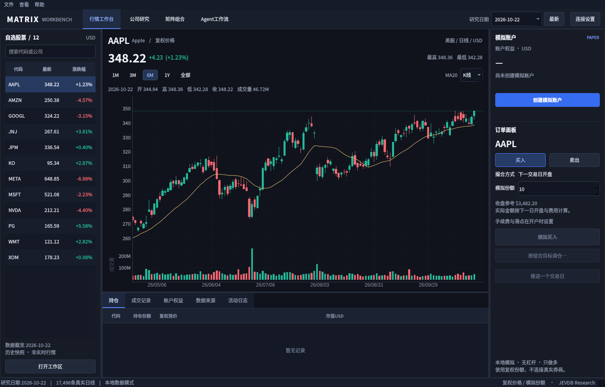
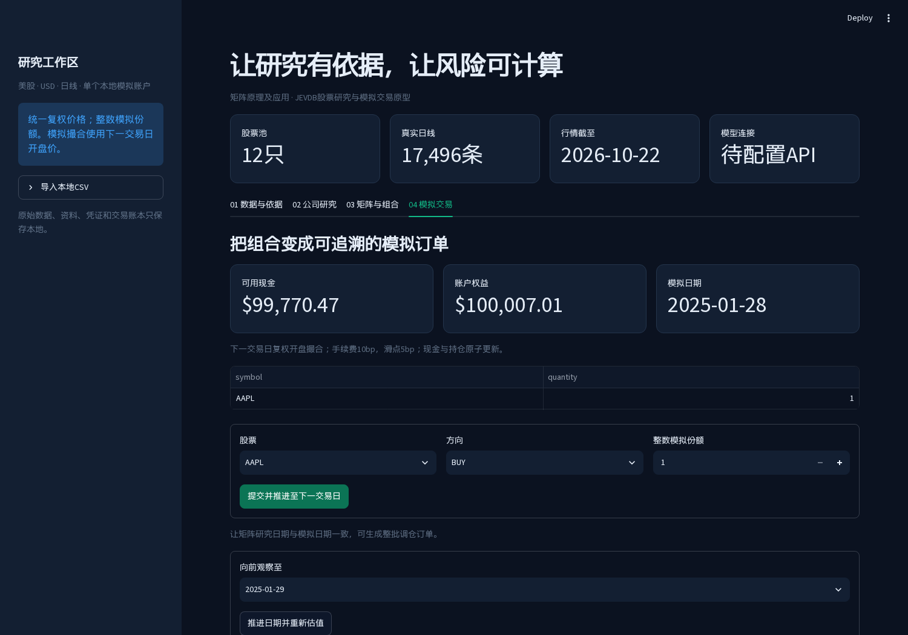

# 项目报告：JEVDB股票研究与矩阵组合模拟

实施日期：2026-10-23；本轮补充：2026-11-25。定位：课程原型；真实模型调用已通过兼容端点完成 40 条评估，成员贡献仍需按实际执行情况填写。

## 摘要

本项目把“资料筛选 → 矩阵风险分析 → 模拟订单 → 账户结果”连成一条可演示的流程：用 JEVDB 语义筛选或明确标记的关键词基线从公司资料中选股，用协方差、收缩、最小方差二次规划、PCA 与风险贡献分析组合，再在 SQLite 事务账本上做次日开盘撮合的纸面交易。

本轮补充的核心结果：

- 关键词基线改为 AND/OR + BM25，并建立 40 条人工标注评估集；关键词 AND 宏 F1 为 0.793。
- 矩阵部分补充 PCA、风险贡献、闭式解与 KKT 对照、收缩路径和年化绩效指标。
- JEVDB 扩展 0.1.0 可加载；默认 Typesafe 后端被地区限制（HTTP 451），改用 DeepSeek 兼容端点并加本地协议适配层后完成 40 条真实查询，0 错误，宏 F1 0.865、MRR 0.906。
- 全量测试 35 通过、2 跳过（跳过项为 Windows 无法导入 `jevdb`）。

这些数字只对应 12 只美股、40 条查询和单次运行，不支持统计显著性结论，也不能外推为 JEVDB 官方后端质量。

## 1. 场景与目标

面向课程小组，把“资料筛选 → 矩阵风险分析 → 模拟订单 → 账户结果”连成可演示流程。用户可以是希望按主题筛选公司、比较组合风险并做纸面交易的学生或研究者。输入是自然语言研究条件、股票池、研究日期、回看长度和收缩系数；输出是带来源与时间戳的筛选依据、协方差与风险诊断、目标权重、订单/成交/持仓/权益记录。

主界面为 Qt 原生桌面工作台（`matrixlab/desktop/`），Streamlit 界面保留为调试与对照。核心逻辑也可通过 Python 模块和 CLI 调用。

| 作业要求 | 当前对应实现 |
|---|---|
| 目标用户、输入输出与核心流程 | 第 1—2 节；Qt 四页签与完整演示步骤 |
| JEVDB 集成 | 扩展 0.1.0 可加载；Typesafe 因地区限制返回 451，llm 后端经本地协议适配层用 DeepSeek 完成 40 条评估，见 5.4 |
| 工具职责、依赖、权限、来源与许可 | `docs/tools.md` 与锁定依赖 |
| 现金、持仓、订单、价格、费用 | SQLite 事务账本，次日开盘、滑点、手续费、幂等与回滚 |
| 矩阵理论联系 | 协方差 Gram 矩阵、半正定、条件数、收缩、QP、PCA、风险贡献、闭式解与 KKT |
| 原型、源码、运行和演示资料 | `matrixlab/`、`app.py`、`docs/runbook.md`、截图与 CLI |
| 成员贡献与 multi-agent 核验 | 结构已准备，真实成员填写与核验记录仍待补，见第 9 节 |

主要交付物：

- 源码：`matrixlab/`、`app.py`、`scripts/`、`tests/`；
- 评估：`evaluation/`（12 份文档、40 条标注、评估脚本与结果）；
- 文档：`docs/report.md`、`docs/runbook.md`、`docs/tools.md`、`docs/verification/`；
- 界面截图：`docs/images/`。

## 2. 系统架构与数据流

```text
Yahoo chart API ──► prices.csv ──┐
Wikipedia 历史版本 ──► documents.csv ──┤
                                      ├─► research.screen ──► ResearchRun(JSON)
JEVDB / 远程语义服务 ─────────────────┘          │
                                                ▼
                              analytics.analyze / holdout_curve
                                                │
                                                ▼
                              trading.Broker ──► paper.sqlite3
                                                │
                                                ▼
                                   Qt / Streamlit 展示 + CSV/JSON 导出
```

| 模块 | 文件 | 职责 |
|---|---|---|
| 采集 | `matrixlab/acquire.py` | 行情与百科资料采集，保留来源、版本和获取时间 |
| 数据校验 | `matrixlab/data.py` | CSV 校验、时间边界、数据质量检查 |
| 研究筛选 | `matrixlab/research.py` | JEVDB 语义筛选与明确分离的关键词基线，保存研究记录 |
| 矩阵分析 | `matrixlab/analytics.py` | 协方差、收缩、QP、PCA、风险贡献、样本外曲线与绩效 |
| 模拟交易 | `matrixlab/trading.py` | SQLite 事务账本、次日开盘撮合、费用与幂等 |
| 远程语义服务 | `matrixlab/service.py` | 可选的 JEVDB 语义服务，带 HMAC 请求签名 |
| 协议适配 | `scripts/jev_llm_proxy.py` | 把 JEVDB 的 `json_schema` 请求转换为兼容端点的 `json_object` 调用 |
| 评估 | `evaluation/evaluate.py` | 40 条人工标注的诊断评估 |

### 2.1 界面






## 3. 数据与时间边界

原运行成功获取 12 只美股、17,496 条日线，覆盖 2021-01-04 至 2026-10-22；每行保留 Yahoo 来源端点和获取时间。下载的 12 份当前公司简介只在获取之后可用，不能用于过去的历史选股。

另成功获取 5 份截至 2024-12-31 的 Wikipedia 公司介绍版本，保存确切版本 ID 和时间；其余 7 份发生 HTTP 访问失败，详情保存在本地 `data/archive-manifest.json`，未生成替代资料。历史关键词演示在 2025-01-27 可用的 5 份资料中命中 4 份；这是关键词演示，不是语义准确率。

训练使用研究日期及之前的行情，收益率不向前填充；共同有效观测不足 60 行时停止。样本外曲线从下一交易日复权开盘开始，避免用当天收盘价产生当天成交。股票池由当前选择形成，仍有幸存者偏差；下载的是供应商当前修订后的历史快照，不能声称重现当时全部可见信息。

本工作副本不附带 `data/`、`.env` 或任何密钥；报告中的原始数据指标来自 2026-10 的本机运行，重新复现需要按 `docs/runbook.md` 重新下载数据并配置端点。

## 4. 矩阵方法

令 `R` 为 `T×N` 的日收益率矩阵，`X` 为逐列去均值后的矩阵。

### 4.1 协方差 Gram 矩阵

```text
Σ = 252 · XᵀX / (T−1)
```

对任意向量 `v`，`vᵀXᵀXv = ||Xv||² ≥ 0`，因此样本协方差半正定；当 `T > N` 且 `X` 列满秩时正定。程序检查最小特征值是否为正，并用 `κ(Σ)=λmax/λmin` 度量病态程度。

### 4.2 收缩与条件数

```text
Σ_α = (1−α)Σ + α · tr(Σ)/N · I,   0 ≤ α ≤ 1
```

向等方差对角目标收缩可降低条件数、稳定权重；`α=1` 时目标矩阵为数量矩阵，只做多最小方差解退化为等权。界面给出 `κ(Σ)`、`κ(Σ_α)` 与收缩路径。

### 4.3 最小方差二次规划

```text
min_w  wᵀΣ_αw
s.t.   1ᵀw = 1,  w ≥ 0
```

程序用 SLSQP 求解，目标按 `tr(Σ)/N` 归一化以避免量级过小导致提前停止，并检查收敛、非负性和权重和。

### 4.4 无约束闭式解与 KKT

对等式约束拉格朗日函数：

```text
L = wᵀΣ_αw + λ(1ᵀw − 1)
∂L/∂w = 2Σ_αw + λ1 = 0
⇒ w* = Σ_α⁻¹1 / (1ᵀΣ_α⁻¹1)
```

若 `w* ≥ 0`，则它就是只做多 QP 的解；若出现负权重，非负约束起作用，QP 目标值高于无约束最优值。程序同时计算闭式解、最小权重与目标差，作为数值校验和教学对照。加入 `w ≥ 0` 后 KKT 条件为：

```text
2Σ_αw + λ1 − μ = 0,   μ ≥ 0,   μᵢwᵢ = 0
```

### 4.5 PCA 与风险贡献

对相关系数矩阵 `C = D^(−1/2)ΣD^(−1/2)` 做特征分解 `C = VΛVᵀ`，按特征值降序得到主成分载荷与解释方差；界面显示前三个主成分和累计解释比例。

组合波动率 `σ_p = sqrt(wᵀΣw)`。边际风险贡献与成分风险贡献为：

```text
MCTRᵢ = (Σw)ᵢ / σ_p
CTRᵢ  = wᵢ · MCTRᵢ
Σᵢ CTRᵢ = σ_p
```

风险占比 `CTRᵢ/σ_p` 之和为 1。该分解使用原始 `Σ`；权重优化使用 `Σ_α`，界面同时标注两种波动率，避免混淆。

### 4.6 样本外与绩效

`holdout_curve` 从信号日下一交易日的复权开盘入场，按买入持有计算组合与等权基准。绩效定义（无风险利率按 0）：

```text
累计收益 = 末值 / 初值 − 1
年化收益 = (1 + 累计收益)^(252 / 持有期数) − 1
年化波动率 = std(日收益, ddof=1) · √252
夏普比率 = 年化收益 / 年化波动率
最大回撤 = min(净值 / 历史最高净值 − 1)
```

年化按 252 个交易日折算，样本较短时年化值波动较大，只用于同口径比较。

### 4.7 数值自检

在 12 资产、420 个交易日的合成数据上（`α=0.1`）：条件数 14.44 → 11.47，PC1 解释 46.4%，风险占比之和为 1，闭式解最小权重 −3.5%（非负约束起作用），收缩路径 `α=0/0.5/1` 的条件数为 14.44/4.78/1.00。以上是**合成数据自检**，不是真实行情结论；原真实数据运行的条件数为 48.30 → 33.47（截至 2025-01-27，252 个共同日收益率）。

## 5. 研究筛选与评估

### 5.1 关键词基线

默认要求全部词命中（AND），可切换 OR；支持引号短语、英文停用词、轻量词形归一和 CJK bigram，并按 BM25 排序，结果附带 `match_score`。英文按停用词过滤后做轻量词形归一（复数、`-ies`）；中文没有分词器时使用相邻两字 bigram。BM25 采用 `k1=1.5, b=0.75`：

```text
score(q,d) = Σ_t idf(t) · f(t,d)·(k1+1) / (f(t,d) + k1·(1−b+b·|d|/avg|d|))
idf(t) = ln(1 + (N − n_t + 0.5)/(n_t + 0.5))
```

短语命中在 BM25 分数上叠加出现次数，作为排序加权。它是透明的词面基线，不能等同 JEVDB 语义质量；关键词结果不会自动改写成“语义结果”。

### 5.2 评估设计

`evaluation/documents.csv` 是 12 家公司的简短介绍（小组成员自行撰写，不复制百科原文）；`evaluation/labels.csv` 是 40 条“查询 → 相关公司代码”的人工标注。相关性按业务判断，可能与关键词是否出现无关。

指标以公司代码为相关性单位：

```text
P = |命中 ∩ 相关| / |命中|        （命中为空时记 0）
R = |命中 ∩ 相关| / |相关|
F1 = 2PR / (P + R)
MRR = 1 / 第一个相关结果的排名     （没有相关结果时记 0）
精确匹配 = 命中集合与相关集合完全相同
```

宏平均是 40 条查询指标的算术平均；微平均按全部查询汇总命中与相关计数后计算。空结果记 P=0 会压低关键词基线的宏平均精确率，这是有意的惩罚：对用户来说，返回空列表并不等于“没有错误”。

### 5.3 结果与错误分析

| 模式 | 宏平均 Precision | 宏平均 Recall | 宏平均 F1 | MRR | 精确匹配率 |
|---|---:|---:|---:|---:|---:|
| 关键词 AND + BM25 | 0.850 | 0.769 | 0.793 | 0.850 | 0.700 |
| 关键词 OR + BM25 | 0.729 | 0.844 | 0.730 | 0.925 | 0.500 |
| JEVDB（DeepSeek 兼容端点） | 0.826 | 0.969 | 0.865 | 0.906 | 0.600 |

JEVDB 的召回率明显更高（0.969 对 0.769），F1 与 MRR 也更高；代价是精确率略低（0.826 对 0.850）。三种模式的错误形态不同：

| 现象 | 关键词 AND | JEVDB |
|---|---:|---:|
| 返回空结果 | 6 条 | 0 条 |
| 有冗余选中 | 0 条 | 16 条 |
| 有漏选 | 13 条 | 3 条 |
| 精确匹配 | 28/40 | 24/40 |

关键词的失败集中在词形、同义和上位词：`graphics processors` 对 `graphics processing units`、`search engine` 对 `Google Search`、`operating systems` 对 `Windows/Android`、`technology mega-caps` 对六家公司的分散表述。它几乎不产生冗余（精确率在非空查询上都是 1.0），但 6 条查询直接返回空。

JEVDB 的失败主要是“相关就选”的过度包含：`cloud computing` 额外选中 AAPL/NVDA，`digital payments` 命中 6 家，`data centers` 命中 6 家，`search engine` 额外选 MSFT。冗余次数最多的是 AAPL（4 次）、GOOGL（4 次）、MSFT/WMT/META（各 3 次）。漏选只有 3 处：`household products` 漏 WMT、`streaming video` 漏 AMZN、`consumer staples` 漏 JNJ。

因此结论不是“语义筛选全面更优”，而是**它用精确率换召回率**：当用户希望“尽量不漏”时语义模式更好；当用户要求结果集合干净时，关键词基线反而更稳。精确匹配率也是关键词更高（0.700 对 0.600）。要同时提高两者，需要更明确的业务定义、阈值或二次判定，而不是简单换后端。

### 5.4 JEVDB 实际运行状态

2026-11-25 在 WSL2 Ubuntu 24.04 安装 `jevdb==0.1.0` 与 `duckdb==1.4.3`，扩展可加载并注册 `jev_holds`、`jev_score`、`jev_choose` 等函数。默认 Typesafe 后端返回：

```text
HTTP 451: Typesafe is not available in your region.
```

因此改走 `MATRIX_BACKEND=llm`。DeepSeek 的 Chat Completions 只接受 `response_format={"type":"json_object"}`，而 JEVDB 固定发送 `json_schema`，直连返回 HTTP 400（`This response_format type is unavailable now`）。为此增加本地协议适配层 `scripts/jev_llm_proxy.py`：把 schema 注入提示词、以 `json_object` 调用上游、按 schema 校验并在失败时重试。**语义判断仍由 DeepSeek 完成**，代理只做格式转换，不能称作 JEVDB 原生支持的提供商。

实际运行（`deepseek-flash`，`temperature=0`）：

```text
40 条查询，40 条成功，0 错误
上游请求 41 次，其中 5 次为 schema 校验重试，最终失败 0
prompt 37689 tokens，completion 42792 tokens，合计 80481
累计约 403 秒，单次最长 56.3 秒
```

逐条结果见 `evaluation/results/both-deepseek.json`；扩展注册、451、400、代理转换与上述统计的完整证据见 `docs/verification/jevdb-smoke-2026-11-25.md`。

仍需注意：这是单次运行、40 条查询；温度设 0 只能降低而不能消除模型波动，更换模型、关闭兼容层或改用 Typesafe 都会改变指标；费用需按供应商当期价格核对，本报告只记录 token 数。

## 6. 模拟交易机制

固定研究日收盘后生成信号，在下一交易日复权开盘按方向计入滑点，手续费单列。组合调仓按信号日收盘估算整数份额，预留 5% 现金；次日跳空可能使资金不足，此时整批拒绝。

账户现金以整数微美元保存。每批订单使用 SQLite 即时写事务，先卖后买，任意无效订单导致现金、持仓、成交和快照全部回滚。同一请求编号与相同内容只成交一次；相同编号用于其他内容会被拒绝。时钟只能前进，无下一日行情、缺失开盘价或持仓估值价时不假设成交。

统一复权价格已经包含供应商的拆股和股息调整，所以模拟份额不再重复分拆或收取股息。这是明确简化的课程价格单位，不还原真实历史股数、结算、停牌、税费和券商行为。样本外曲线使用可分份额、一次建仓后持有；逐笔账本使用整数份额，两者结果不可直接视为相同。

## 7. 测试、复现与证据

2026-11-25 在本机运行：

```text
35 passed, 2 skipped
```

跳过的是 Windows 无法导入 `jevdb` 的两条 JEVDB 测试。覆盖范围包括：协方差与闭式解对照、PCA 正交性与解释方差、风险贡献求和、收缩路径端点、样本外曲线、绩效指标、未来数据隔离、订单边界、费用核对、整批回滚、重复提交、资料时间过滤、桌面界面与 Streamlit 界面流程。

```bash
python -m pytest -q
python evaluation/evaluate.py --mode keyword --operator all
python evaluation/evaluate.py --mode keyword --operator any
python evaluation/evaluate.py --mode both          # 需可用端点
```

JEVDB 评估在 WSL 的独立 venv 中执行，`MATRIX_API_ENDPOINT` 指向本机协议适配层；代理启动与端点配置见 `docs/runbook.md`。复现时需要先 `fetch` 行情、`archive` 历史资料，并在本地 `.env` 配置端点与密钥。

报告中的关键结论与对应证据：

| 结论 | 证据文件 |
|---|---|
| 关键词 AND/OR 指标 | `evaluation/results/keyword-all.json`、`keyword-any.json` |
| JEVDB 与关键词对照 | `evaluation/results/both-deepseek.json` |
| 无密钥时的显式报错 | `evaluation/results/jevdb-blocked.json` |
| 扩展注册、451、400、代理转换 | `docs/verification/jevdb-smoke-2026-11-25.md`、`.json` |
| 依赖、权限与许可 | `docs/tools.md`、`requirements.lock` |
| 界面展示 | `docs/images/desktop-*.png`、`paper-trading.png` |

## 8. 局限

- 股票池只有 12 只美国大盘股，存在幸存者偏差；结论不外推到全市场。
- 历史资料来自百科叙述，不是财报或电话会议；语义质量仍需独立核验。
- 评估集只有 40 条人工标注，且文档是简短自写摘要，只用于诊断，不支持统计显著性结论。
- JEVDB 语义结果来自 DeepSeek 兼容端点与本地协议适配层，不是 Typesafe 原生服务；只运行一次 40 条查询，费用未按当期价格折算。
- 关键词与 JEVDB 的对比受“空结果记 P=0”的口径影响；换口径会改变宏平均精确率。
- 模拟交易为单账户、只做多、整数份额、统一复权价，不还原真实券商结算、停牌、税费和公司行动。
- 样本外只做单次建仓持有，尚未加入按月滚动调仓、换手率和基准 SPY。
- 工作副本不含原始数据、密钥和成员贡献记录，复现与提交前需补齐。

## 9. 成员贡献与 multi-agent 核验

此项必须由实际参与的 3—5 名成员填写，不能虚构。建议每人记录：实际负责的文件/提交、独立提出的问题、核验命令与结果、发现并修正的问题、报告的对应章节。multi-agent 核验应至少覆盖数学推导、数据与未来函数、交易账务、引用与许可四类，并保存使用的模型/工具、提示、发现和修正记录。当前仓库只有模板，提交前必须补齐。

## 10. 参考

- JEVDB 作者仓库：<https://github.com/PDAIS/JEVDB>
- 题目论文：<https://arxiv.org/abs/2610.02046v1>
- DeepSeek JSON Output 文档：<https://api-docs.deepseek.com/zh-cn/guides/json_mode/>
- 工具与许可：`docs/tools.md`
- 运行说明：`docs/runbook.md`
- JEVDB 本机验证记录：`docs/verification/jevdb-smoke-2026-11-25.md`
- 评估集说明：`evaluation/README.md`
