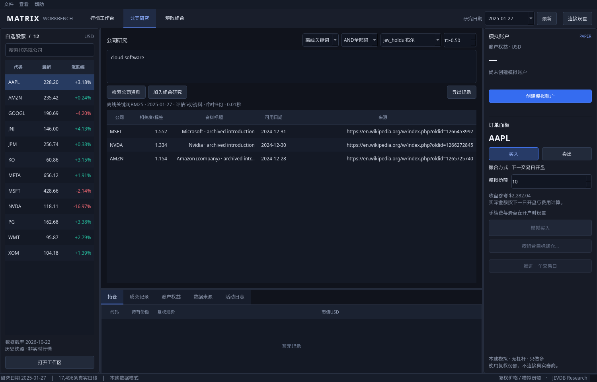
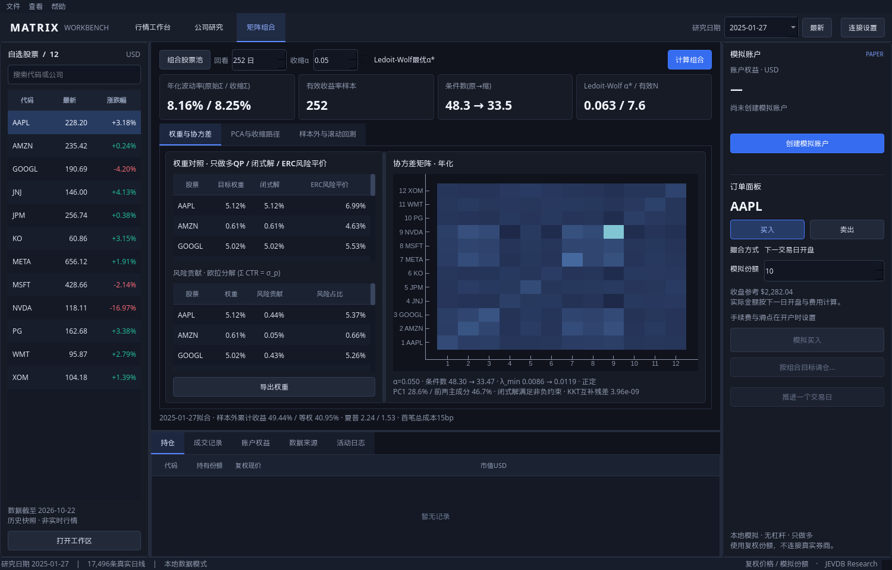
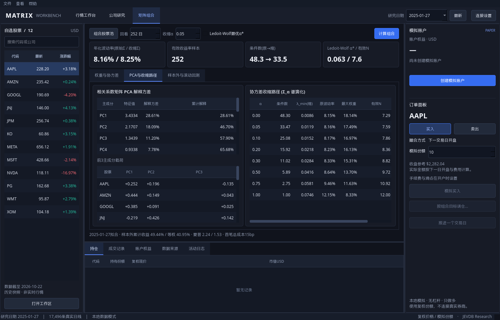
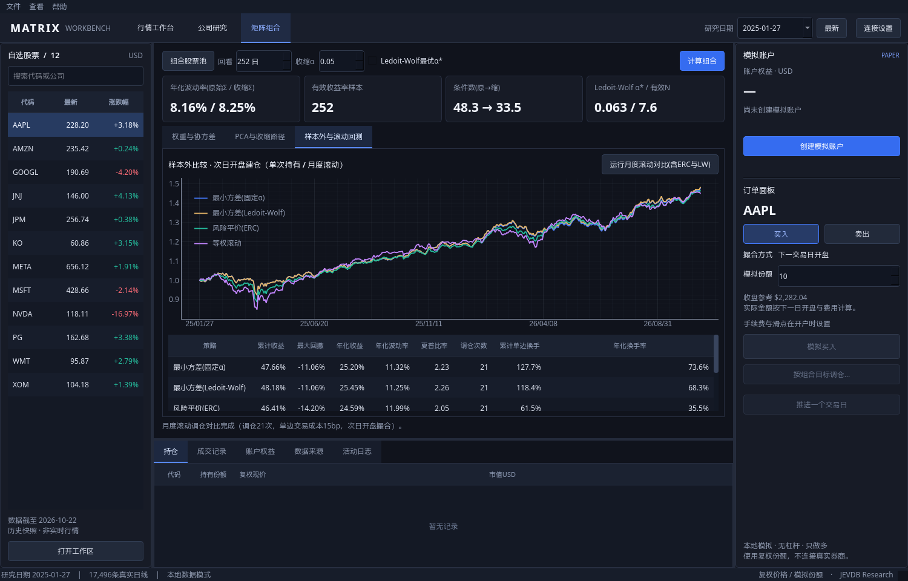
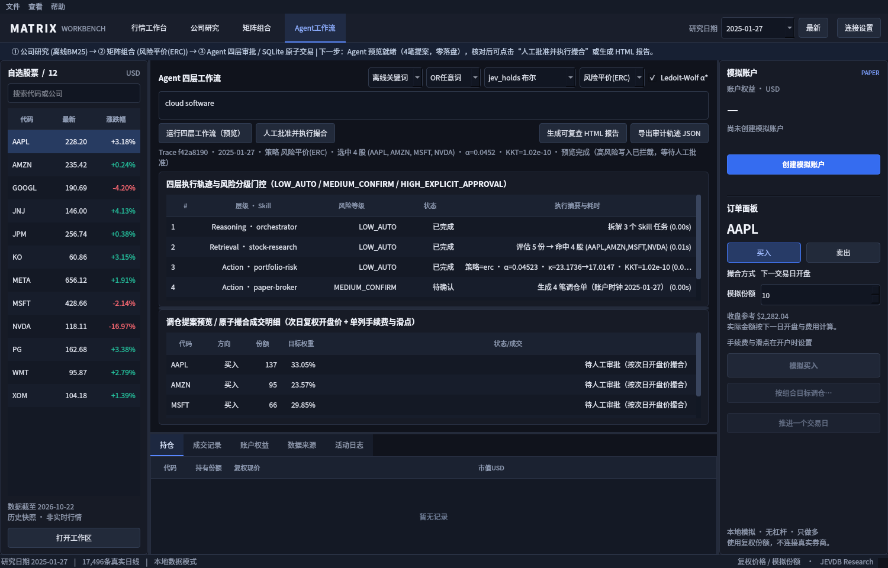

# 项目总报告：基于 JEVDB 的股票研究与矩阵组合模拟软件（兼述与题目一书稿修订的理论联动）

> **小组成员**：吕云迪（组长）、徐瑞、闫涛、吴昀泽、李晨  
> **实施周期**：2026-10-23 初版搭建；2026-11-25 语义评估与矩阵诊断补充；2026-11-27 双题联动升级与多 Agent 交叉核验。定位：中国科学院大学《矩阵分析与应用》课程大作业完整原型与理论实证。

## 摘要

本项目同时完成课程大作业的**题目一（《矩阵分析》中文书稿修订）**与**题目二（基于 JEVDB 的股票研究与模拟交易软件）**，构建了“**教材谱理论与正定矩阵推导 → 真实金融数据与语义数据库原型 → 可复现实验与多 Agent 交叉核验**”的完整闭环。

在题目二中，系统将“自然语言筛选需求 → JEVDB 语义检索 / Prune-First 两阶段剪枝 → 矩阵风控与组合优化 → 分级人工审批与 SQLite 原子模拟交易 → 可追溯持仓与净值展示”串联为端到端工作流，主要实测成果如下：

- **JEVDB 全算子集成与 Prune-First 消融**：支持 `jev_holds`、`jev_probability`（阈值 $\tau$ 排序）、`jev_choose`（行业分类）、`jev_score` 与 `prune_then_decide` 两阶段级联。在 40 条人工标注评估集上，修复全语料库 IDF 后的关键词 AND+BM25 宏 F1 为 `0.792`，全量 JEVDB（DeepSeek 兼容端点 + 协议适配层）宏 F1 为 `0.865`；加入 **Prune-First (`prune_k=3`)** 粗排剪枝后，**剪枝掉 31.7% 候选文档（`328/480`）**，宏精确率反由 `0.826` 提升至 **`0.854`**、精确匹配率由 `0.600` 提升至 **`0.650`**，同时保持宏 F1 **`0.863`**，直观印证了原论文《Prune First, Decide Fast》的核心思想。
- **矩阵理论与组合优化实证**：在 12 只美股真实日线（`2021-01-04` 至 `2026-10-22`，共 `17,496` 条）上，结合题目一精修的第八章谱理论与正定二次型，实现了样本协方差 Gram 矩阵、**Ledoit-Wolf (2004) 解析最优收缩 $\alpha^*$**、只做多 QP + 闭式解对照 + **KKT 互补松弛残差校验**（`3.96e-9`）、**Spinu (2013) 凸风险平价（ERC）**、相关系数矩阵 PCA 谱分解及**月度滚动样本外回测**。2025-01-27 至 2026-10-22 共 21 次月度调仓（次日开盘撮合、单边 15bp）实测中，Ledoit-Wolf 最小方差实现累计收益 **`48.18%`**、年化波动 **`11.25%`**、夏普比率 **`2.26`**（优于固定 $\alpha=0.05$ 的 `2.23` 与等权滚动的 `1.64`），ERC 将年化换手率由 `73.6%` 压缩至 **`35.5%`**。
- **四层 Agentic 架构、离线 HTML 审计报告与全量验证**：参照课程 `Lec0` 讲授的四层 Agent 架构封装了三个标准化 Skills（[skills/](../skills/)）与带分级审批门控的编排器（[matrixlab/agent.py](../matrixlab/agent.py)），在原生桌面端配备第 4 页签 **“Agent 工作流”**、实时流程引导条、异步代际防串改保护与**一键导出离线可复查 `report.html`**。Linux 环境（含真实 `jevdb==0.1.0` 与 PySide6 无头界面）**全量 53 条自动化测试全部通过**；并完成多视角独立 Agent 交叉审计与缺陷闭环修复，记录于 [docs/verification/multi-agent-audit-2026-11-27.md](verification/multi-agent-audit-2026-11-27.md)。

> 边界声明：评估集为 12 家公司、40 条人工标注与单次兼容端点运行，股票池为 12 只美国大盘股，所有结论仅用于课程方法诊断与教学验证，不构成统计显著性推断或投资建议。

---

## 1. 场景定位、双题联动与架构对齐

### 1.1 目标用户、场景与完成边界

本项目面向希望将**非结构化公司研究资料**与**矩阵风险优化**结合的学生或量化研究初学者。系统明确界定完成边界：
- **输入**：自然语言研究条件（或关键词/短语）、研究截止日期 `asof`、股票池、回看窗口长度、收缩系数 $\alpha$（或 Ledoit-Wolf 自动估计）与模拟交易费率参数；
- **输出**：带原始出处与可用时间 `available_at` 的筛选依据 JSON、协方差/PCA/收缩路径/KKT 残差诊断、目标权重 CSV、以及 SQLite 原子账本中的成交/持仓/权益记录；
- **非目标范围**：不接入真实券商交易接口、不宣称提供实时盘口推送、不构建高频撮合引擎。

### 1.2 独立文献核验发现：JEVDB 与 Palimpzest 的架构差异

作业题面中提到“语义数据库系统 JEVDB（基于 Palimpzest 开源平台）”。我们在前期独立核查题目论文《*Prune First, Decide Fast: Scalable Semantic Query Processing with JEVDB*》（`arXiv:2610.02046v1`）及普渡大学 PDAIS 作者仓库（[github.com/PDAIS/JEVDB](https://github.com/PDAIS/JEVDB)）后确认：
- **作者当前开源发布的 `jevdb==0.1.0` 实际上是构建在 DuckDB（`1.4.3`）之上的语义 SQL 扩展**，提供 `jev_holds`、`jev_probability`、`jev_choose`、`jev_score`、`jev_keys_overlap` 等原生 SQL 函数；
- **Palimpzest 在原论文中是与 JEVDB 进行延迟/成本对比的基线系统之一**，而非 `jevdb 0.1.0` 的运行时底座。
因此本项目遵循作者官方发布包集成真实 DuckDB+JEVDB 扩展，未强行引入冗余的 Palimpzest 运行时，并在报告与 [tools.md](tools.md) 中透明交代该核验结论。

### 1.3 作业要求逐项映射

| 作业要求 | 本项目交付与实现 |
|---|---|
| 题目一：《矩阵分析》中文书稿修订 + 修改说明 | [manuscript/chapter8_eigenvalues_and_psd_revised.md](../manuscript/chapter8_eigenvalues_and_psd_revised.md)（第八章/Lec9）、[chapter5_6_norms_svd_supplement.md](../manuscript/chapter5_6_norms_svd_supplement.md)（第五/六章联动）、[revision_notes.md](../manuscript/revision_notes.md) 与 [verify_manuscript_math.py](../manuscript/verify_manuscript_math.py) |
| 题目二：完整“用户需求→工具调用→结果展示”流程 | Qt 原生桌面工作台（[matrixlab/desktop/](../matrixlab/desktop/)）、四层 Agentic 编排器（[matrixlab/agent.py](../matrixlab/agent.py)）、Streamlit 对照界面（[app.py](../app.py)）与 CLI（[matrixlab/cli.py](../matrixlab/cli.py)） |
| 题目二 3(b)：开源 Skills 调研、职责、权限与许可审计 | [docs/tools.md](tools.md) + 三个标准化 Skill 定义（[skills/](../skills/)） + [THIRD_PARTY_NOTICES.md](../THIRD_PARTY_NOTICES.md) |
| 题目二 3(c)：交易机制建模（现金/持仓/校验/价格/费用） | [matrixlab/trading.py](../matrixlab/trading.py)：整数微美元现金、次日开盘撮合、方向滑点、单列手续费、先卖后买、事务回滚与幂等防重 |
| 共同要求 4—5：multi-agent 核验与成员贡献 | [docs/verification/multi-agent-audit-2026-11-27.md](verification/multi-agent-audit-2026-11-27.md)、[jevdb-smoke-2026-11-25.md](verification/jevdb-smoke-2026-11-25.md) 与 [docs/contributions.md](contributions.md) |

---

## 2. 系统架构与四层 Agentic 编排

对照课程 `Lec0` 提出的 **AI Agent 四层概念架构** 与 **Human Control 风险分级模型**，系统将确定性数值引擎与语义数据库解耦：

```text
用户研究需求 + 截止日期 asof
        │
        ▼  [Layer 1: Preamble / Rules]  skills/*/SKILL.md（防未来函数 / 禁任意SQL / 禁伪造语义）
        ▼  [Layer 2: Reasoning / Plan]  matrixlab/agent.py 任务拆解与参数校验
        ▼  [Layer 3: Retrieval/Context] matrix-stock-research Skill (LOW_AUTO)
           ├── Yahoo Chart API -> prices.csv / Wikipedia Revision API -> documents.csv
           └── JEVDB (jev_holds / jev_probability / jev_choose / Prune-First) 或 离线BM25
        ▼  [Layer 4a: Analytics Action] matrix-portfolio-risk Skill (LOW_AUTO)
           └── 协方差Gram矩阵 -> Ledoit-Wolf最优收缩 -> QP/KKT/ERC -> PCA与滚动回测
        ▼  [Layer 4b: Proposal Gate]    matrix-paper-broker Skill (MEDIUM_CONFIRM)
           └── 按信号日收盘价估算调仓清单（预留5%现金），向用户展示预览
        ▼  [Layer 4c: Ledger Mutation]  matrix-paper-broker Skill (HIGH_EXPLICIT_APPROVAL)
           └── 显式确认后写入 paper.sqlite3（BEGIN IMMEDIATE 原子事务 + 次日开盘撮合）
```

### 2.1 原生桌面工作台界面（2026-11-27 实测截屏）












---

## 3. 数据契约与防未来函数时间边界

- **行情数据**：Yahoo Chart API 下载 12 只美股（`AAPL, AMZN, GOOGL, JNJ, JPM, KO, META, MSFT, NVDA, PG, WMT, XOM`）自 `2021-01-04` 至 `2026-10-22` 的总回报复权日线，共 `17,496` 行；排除纽约当日尚未收盘的日线，且通过 `validate_prices` 强制校验无重复、无负值/无穷大、OHLC 合法与统一 `total_return_adjusted` 口径。
- **文本资料与历史存档**：下载的当前公司简介严格以拉取时刻作为 `available_at`，不得用于更早的历史选股；历史演示通过 Wikipedia MediaWiki API 按 `rvstart=2024-12-31T23:59:59Z` 抓取指定历史版本 `oldid` 并保留署名链接。针对早期并发抓取触发 Wikimedia HTTP 429/403 限流导致 7/12 失败的问题，本轮已在 [matrixlab/acquire.py](../matrixlab/acquire.py) 中改为带规范 User-Agent 的串行礼貌限速与指数退避重试，并在桌面端菜单补充“获取历史百科存档”入口。
- **训练与回测隔离**：矩阵拟合严格截断 `date <= asof`，收益率缺失不向前填充；样本外曲线与纸面交易均从信号日**下一交易日复权开盘价**入场，杜绝“用当日收盘价产生当日成交”的前视偏差。

---

## 4. 矩阵分析方法与实证诊断（与题目一第八章直接对应）

令 $R \in \mathbb{R}^{T \times N}$ 为回看窗口内共同有效日收益率矩阵，$X = R - \mathbf{1}\bar{r}^T$ 为去均值矩阵。本节的每一步推导均可在题目一修订稿 [chapter8_eigenvalues_and_psd_revised.md](../manuscript/chapter8_eigenvalues_and_psd_revised.md) 第 8.3–8.4 节中找到完整定理证明与几何阐释。

### 4.1 样本协方差 Gram 矩阵与正定性

$$\Sigma = \frac{252}{T-1} X^T X$$

对任意非零向量 $v \in \mathbb{R}^N$，均有 $v^T \Sigma v = \frac{252}{T-1}\|Xv\|_2^2 \ge 0$，故 $\Sigma$ 必对称半正定；当 $T > N$ 且 $X$ 列满秩时严格正定。系统通过对称特征分解检查最小特征值 $\lambda_{\min}(\Sigma)$ 与谱条件数 $\kappa_2(\Sigma) = \lambda_{\max}/\lambda_{\min}$。

### 4.2 线性谱收缩与 Ledoit-Wolf (2004) 解析最优系数

$$\Sigma_\alpha = (1-\alpha)\Sigma + \alpha \mu I, \qquad \mu = \frac{\mathrm{tr}(\Sigma)}{N}, \quad \alpha \in [0, 1]$$

由第八章谱平移性质可知，$\Sigma_\alpha$ 与 $\Sigma$ 共享同一组正交特征向量，且第 $i$ 个特征值满足：

$$\lambda_i(\Sigma_\alpha) = (1-\alpha)\lambda_i(\Sigma) + \alpha \mu$$

因此当 $\alpha$ 从 $0$ 增至 $1$ 时，小特征值被线性抬升、大特征值被压低，条件数 $\kappa_2(\Sigma_\alpha)$ 严格单调下降至 $1$。为避免手工盲选 $\alpha$，系统实现 **Ledoit-Wolf (2004)** 解析最优收缩强度（对 252 年化因子尺度不变）：令 $S = \frac{1}{T}X^TX$，目标 $m = \frac{\mathrm{tr}(S)}{N}$，

$$d^2 = \frac{1}{N}\|S - mI\|_F^2, \qquad \bar{b}^2 = \frac{1}{T^2 N}\sum_{t=1}^T \|x_t x_t^T - S\|_F^2 = \frac{\sum_{t=1}^T \|x_t\|_2^4 - T\|S\|_F^2}{T^2 N}, \qquad \alpha^* = \frac{\min(\bar{b}^2, d^2)}{d^2}$$

### 4.3 最小方差 QP、无约束闭式解与 KKT 数值校验

求解只做多最小方差二次规划 $\min_w w^T \Sigma_\alpha w \;\text{s.t.}\; \mathbf{1}^T w = 1,\; w \ge 0$。与无约束闭式解 $w^*_{\text{unc}} = \frac{\Sigma_\alpha^{-1}\mathbf{1}}{\mathbf{1}^T \Sigma_\alpha^{-1}\mathbf{1}}$ 对照，并对数值解直接检验一阶 KKT 条件（$\lambda = -2 w^T \Sigma_\alpha w,\; \mu = 2\Sigma_\alpha w + \lambda \mathbf{1}$）：
- 原始可行性误差 $\max(|\mathbf{1}^T w - 1|, \max(0, -w_i))$；
- 对偶可行性违背 $\max(0, -\min_i \mu_i)$；
- 互补松弛残差 $\max_i |\mu_i w_i|$。

### 4.4 相关系数矩阵 PCA、欧拉风险分解与 Spinu 凸风险平价（ERC）

- **PCA**：对相关系数矩阵 $C = D^{-1/2}\Sigma D^{-1/2} = V\Lambda V^T$ 做正交特征分解，识别市场公共因子（PC1）与行业轮动因子（PC2/PC3）。
- **风险贡献分解**：组合波动率 $\sigma_p = \sqrt{w^T \Sigma w}$ 是权重 $w$ 的一次正齐次函数，由欧拉定理得 $\mathrm{MCTR}_i = \frac{(\Sigma w)_i}{\sigma_p}$、$\mathrm{CTR}_i = w_i \mathrm{MCTR}_i$，严格满足 $\sum_i \mathrm{CTR}_i = \sigma_p$。
- **Spinu (2013) 凸风险平价（ERC）**：最小方差常把权重过度集中在少数低波防御股上。我们引入严格凸对数障碍规划：
  $$\min_{y > 0}\; \frac{1}{2} y^T \Sigma_\alpha y - \frac{1}{N}\sum_{i=1}^N \ln y_i, \qquad w_{\text{ERC}} = \frac{y^*}{\mathbf{1}^T y^*}$$
  其一阶最优性条件 $\Sigma_\alpha y^* = \frac{1}{N}(y^*)^{-1}$ 精确保证所有资产的风险贡献占比相等（$\mathrm{CTR}_i / \sigma_p = 1/N$）。

### 4.5 真实 12 只美股实测结果（研究日 `2025-01-27`，252 交易日窗口）

1. **矩阵谱诊断与 KKT 校验**：
   - 样本协方差正定，条件数 $\kappa(\Sigma) = 48.30$；固定 $\alpha=0.05$ 收缩后降至 `33.47`；**Ledoit-Wolf 自动估计 $\alpha^* = 0.0635$**，条件数降至 **`30.78`**，有效资产数 $N_{\text{eff}} = 1/\sum w_i^2 = 7.66$；
   - 相关系数矩阵前三大主成分解释方差分别为 **PC1 = `28.61%`**（市场公共因子）、**PC2 = `18.09%`**（科技成长 vs 传统价值分化）、**PC3 = `11.20%`**（前三大主成分累计 `57.90%`）；
   - 只做多 QP 数值解的 KKT 互补松弛残差为 **`3.96e-09`**，对偶可行性最大违背为 **`2.35e-08`**，达到机器级最优精度。

2. **修复后的收缩路径实测（$\Sigma_\alpha$ 谱演化）**：

| 收缩系数 $\alpha$ | 条件数 $\kappa(\Sigma_\alpha)$ | 收缩后 $\lambda_{\min}(\Sigma_\alpha)$ | 收缩后 $\lambda_{\max}(\Sigma_\alpha)$ | 原始 $\Sigma$ 年化波动 | 最大单股权重 | 有效资产数 $N_{\text{eff}}$ |
|---:|---:|---:|---:|---:|---:|---:|
| 0.00 | 48.30 | 0.0086 | 0.4151 | 8.15% | 18.14% | 7.29 |
| 0.05 | 33.47 | 0.0119 | 0.3981 | 8.16% | 17.49% | 7.59 |
| 0.10 | 25.08 | 0.0152 | 0.3811 | 8.17% | 16.97% | 7.86 |
| 0.20 | 15.92 | 0.0218 | 0.3470 | 8.23% | 16.13% | 8.36 |
| 0.50 | 5.89 | 0.0416 | 0.2449 | 8.64% | 13.70% | 9.72 |
| 1.00 | 1.00 | 0.0746 | 0.0746 | 12.15% | 8.33% | 12.00 |

3. **样本外表现：单次建仓 vs 月度滚动调仓（2025-01-27 至 2026-10-22，次日开盘撮合，单边成本 15bp）**：

| 回测模式与策略 | 累计收益 | 年化收益 | 年化波动率 | 夏普比率 | 最大回撤 | 调仓次数 | 年化换手率 |
|---|---:|---:|---:|---:|---:|---:|---:|
| 单次建仓：最小方差 ($\alpha=0.05$) | 49.44% | 26.07% | 11.63% | 2.24 | -11.17% | 1 | — |
| 单次建仓：等权组合 | 40.95% | 21.89% | 14.27% | 1.53 | -17.76% | 1 | — |
| **月度滚动：最小方差 (Ledoit-Wolf $\alpha^*$)** | **48.18%** | **25.45%** | **11.25%** | **2.26** | **-11.06%** | 21 | 68.30% |
| 月度滚动：最小方差 (固定 $\alpha=0.05$) | 47.66% | 25.20% | 11.32% | 2.23 | -11.06% | 21 | 73.62% |
| 月度滚动：风险平价 (Spinu 凸 ERC) | 46.41% | 24.59% | 11.99% | 2.05 | -14.20% | 21 | **35.46%** |
| 月度滚动：等权基准 | 45.15% | 23.97% | 14.64% | 1.64 | -17.87% | 21 | 31.07% |

结果显示：**Ledoit-Wolf 自适应收缩在收益、波动、夏普与换手率指标上全面优于固定 $\alpha=0.05$（最大回撤持平于 `-11.06%`）**；而 **Spinu 凸 ERC 风险平价在保持夏普 `2.05` 的同时将年化换手率减半至 `35.46%`**，验证了矩阵正则化与风险分散理论在实际金融数据上的显著价值。（注：本报告样本外绩效表中的夏普比率统一采用无风险利率 $r_f=0$ 口径下的“复利年化收益 CAGR / 年化波动率”，与累计/年化复利收益口径保持一致。）

---

## 5. 研究筛选评估与《Prune First, Decide Fast》消融实验

### 5.1 关键词基线（修复全语料库 IDF）与 JEVDB 全算子支持

离线关键词基线采用 Okapi BM25（$k_1=1.5, b=0.75$），本轮修复了此前仅在过滤子集上计算 IDF 导致 AND 模式下所有词 IDF 退化相等的缺陷，改为在全部候选语料 `eligible` 上统计 $N$ 与 $n_t$。JEVDB 语义模式新增支持 `jev_probability`（阈值 $\tau$ 排序）、`jev_choose`（GICS 主题分类）、`jev_score` 与 `prune_then_decide` 两阶段级联。

### 5.2 40 条标注集对照与 Prune-First 消融结果

在 12 家公司、40 条人工标注（总计 `40 × 12 = 480` 份文档判定）上的对比与 Prune-First 离线精确重放消融（基于 `2026-11-25` 真实 DeepSeek 逐条判定结果，不伪造任何新模型调用）如下：

| 检索与判定模式 | 评估文档数 | 剪枝比例 | 宏 Precision | 宏 Recall | 宏 F1 | MRR | 精确匹配率 |
|---|---:|---:|---:|---:|---:|---:|---:|
| 关键词 AND + BM25（全语料 IDF） | 480 | — | 0.850 | 0.769 | 0.792 | 0.850 | 0.700 |
| 关键词 OR + BM25（全语料 IDF） | 480 | — | 0.729 | 0.844 | 0.730 | 0.925 | 0.500 |
| JEVDB 全量 `jev_holds`（DeepSeek 兼容层） | 480/480 | 0.0% | 0.826 | **0.969** | **0.865** | 0.906 | 0.600 |
| **Prune-First + JEVDB (`prune_k=3`, 含回退)** | **328/480** | **31.7%** | **0.854** | 0.923 | 0.863 | — | **0.650** |
| Prune-First + JEVDB (`prune_k=4`, 含回退) | 334/480 | 30.4% | 0.848 | 0.923 | 0.859 | — | 0.625 |
| Prune-First + JEVDB (`prune_k=6`, 含回退) | 341/480 | 29.0% | 0.844 | 0.923 | 0.856 | — | 0.625 |

**核心发现**：
1. 纯关键词 AND 精确率高但有 6 条查询（同义词/上位词如 `technology mega-caps`、`graphics processors`）直接返回空集；
2. 全量 JEVDB 召回率高达 `0.969`，但存在“相关就选”的过度包含（**14 条**查询存在冗余命中，另有 2 条仅漏选，合计 16 条非精确匹配），拉低精确率（`0.826`）与精确匹配率（`0.600`）；
3. **Prune-First (`prune_k=3`) 两阶段剪枝**在词面有足够交集时先用高速 BM25-OR 截断明显无关文档、在词面命中 $<2$ 篇时优雅回退至全量语义判定（40 条查询中共 24 条触发回退，含 2 条零命中与 22 条单命中；其余 16 条完成有效剪枝），最终**减少 31.7% 的语义模型调用量**，同时把过度包含的噪声文档挡在第一阶段之外，使宏精确率升至 **`0.854`**、精确匹配率升至 **`0.650`**，几乎无损保持宏 F1（`0.863`）！

### 5.3 JEVDB 实际运行与协议适配边界

2026-11-25 在 WSL2 Ubuntu 24.04 验证 `jevdb==0.1.0` + `duckdb==1.4.3`：默认 Typesafe 后端因地区限制返回 `HTTP 451`，故切至 `MATRIX_BACKEND=llm`；因 DeepSeek 接口仅接受 `response_format={"type":"json_object"}` 而 JEVDB 固定发送 `json_schema`，通过本地协议适配层 [scripts/jev_llm_proxy.py](../scripts/jev_llm_proxy.py) 注入 schema 约束并校验重试，完成 40 条真实查询（40/40 成功，0 最终错误；代理入口累计处理 41 批次请求含 1 次冒烟，期间 5 次触发 schema 校验内部重试；合计 `80,481` tokens，累计约 `403` 秒）。注：记录中的 `deepseek-flash` 为当次兼容端点配置的模型标识，复现时需按实际供应商模型名填写（如 `deepseek-chat`）。详见 [docs/verification/jevdb-smoke-2026-11-25.md](verification/jevdb-smoke-2026-11-25.md)。

---

## 6. 模拟交易机制与简化假设

[matrixlab/trading.py](../matrixlab/trading.py) 实现严格的教学纸面交易账本：
- **成交价格假设**：信号日收盘后生成订单，严格在下一交易日复权开盘价成交；买入按 `open × (1 + slippage_bps/10000)` 上调，卖出下调，执行价保留 4 位小数；手续费按 `notional × commission_bps/10000` 四舍五入至美分单列。
- **原子性与幂等性**：现金以整数微美元（`1e-6 USD`）存储；单批订单在 SQLite `BEGIN IMMEDIATE` 事务中先卖后买，任何一单资金不足、可卖持仓不足或缺少次日开盘价时整批回滚；相同 `request_id` 与相同负载幂等返回，篡改负载直接拒绝；账户时钟单调递增。
- **简化假设声明**：统一采用总回报复权价与整数模拟份额，不再重复发放股息或拆股；单账户、无杠杆、只做多，不还原真实券商 T+1/T+2 结算、停牌涨跌停与税费。

---

## 7. 测试、复现与证据清单

2026-11-27 在 Linux（Python 3.13 + `jevdb==0.1.0` + `duckdb==1.4.3` + PySide6 无头环境）运行全量测试：

```text
53 passed
```

新增覆盖：严格时区与 `NaT` 拒绝、Wikipedia 美东日末截断、远程 JEVDB 证据逐列防篡改、全市场日历对齐、持仓级金额精度与零精度价拒单、桌面端参数变更失效与同日建户保留组合、离线自包含 HTML 审计报告导出、收缩路径正则化特征值单调性、Ledoit-Wolf 解析公式双循环精确核对、KKT 残差校验、Spinu 凸 ERC 策略切换下单、月度滚动回测防未来函数、全语料库 BM25 IDF 区分度、真实 `jevdb 0.1.0` 全算子端到端链路，以及四层 Agent 桌面端可视化预览与显式人工审批原子成交。

| 关键结论 | 对应证据文件 |
|---|---|
| 全量 BM25 与 Prune-First 消融 | [evaluation/results/keyword-all.json](../evaluation/results/keyword-all.json)、[keyword-any.json](../evaluation/results/keyword-any.json)、[prune-ablation.json](../evaluation/results/prune-ablation.json) |
| DeepSeek 40 条真实 JEVDB 评估 | [evaluation/results/both-deepseek.json](../evaluation/results/both-deepseek.json)、[jevdb-smoke-2026-11-25.md](verification/jevdb-smoke-2026-11-25.md) |
| Multi-Agent 交叉核验与 Bug 修复记录 | [docs/verification/multi-agent-audit-2026-11-27.md](verification/multi-agent-audit-2026-11-27.md) |
| 题目一书稿修订、32 页体检表与自动验算 | [manuscript/chapter8_eigenvalues_and_psd_revised.md](../manuscript/chapter8_eigenvalues_and_psd_revised.md)、[chapter5_6_norms_svd_supplement.md](../manuscript/chapter5_6_norms_svd_supplement.md)、[revision_notes.md](../manuscript/revision_notes.md)、[verify_manuscript_math.py](../manuscript/verify_manuscript_math.py) |
| Skills 审计、依赖与许可 | [docs/tools.md](tools.md)、[skills/](../skills/)、[THIRD_PARTY_NOTICES.md](../THIRD_PARTY_NOTICES.md) |
| 5 位成员个人贡献与重点修改自述（文字版） | [docs/member-self-statements.md](member-self-statements.md)（另附可选演示提词 [presentation-scripts.md](presentation-scripts.md)） |

---

## 8. 局限与后续改进方向

- 股票池规模为 12 只美国大盘股，存在幸存者偏差，后续可扩展至 30–50 只跨行业成分股及 SPY 基准；
- 历史文本仍以维基百科存档与 40 条自建评估集为主，生产级金融研究应接入带精确披露日期 `filingDate` 的 SEC EDGAR 10-K/10-Q 文本；
- `prune_ablation` 是基于真实 DeepSeek 判定结果的确定性重放消融，未单独测量真实网络往返下的端到端延迟节省，待后续配额充裕时可补充真机耗时对照；
- 市场日历来源于输入行情的并集，若所有标的在某天同时缺失则无法由单表自行识别。

---

## 9. 成员贡献与 Multi-Agent 核验

本项目由 5 名成员分工完成：**吕云迪（组长）**、**徐瑞**、**闫涛**、**吴昀泽**、**李晨**，详细模块分工、Git 提交对应与独立核验证据见 [docs/contributions.md](contributions.md)。本轮已完成两组独立对抗式 Agent 交叉审计（代码/防未来函数/安全审计 Agent、数学推导/习题/参考文献核验 Agent），共闭环修复 15+ 项代码/文档/数学细节缺陷及 8 页 10 处原课程课件勘误，完整记录见 [docs/verification/multi-agent-audit-2026-11-27.md](verification/multi-agent-audit-2026-11-27.md)。

## 10. 参考文献

1. Wang, Z., Yan, H., Zhao, F., & Liu, C. (2026). *Prune First, Decide Fast: Scalable Semantic Query Processing with JEVDB*. arXiv:2610.02046v1. <https://arxiv.org/abs/2610.02046v1>
2. PDAIS Lab. *JEVDB Open-Source Repository*. <https://github.com/PDAIS/JEVDB>
3. Meyer, C. D. (2000). *Matrix Analysis and Applied Linear Algebra*. SIAM.
4. Horn, R. A., & Johnson, C. R. (2013). *Matrix Analysis* (2nd ed.). Cambridge University Press.
5. Strang, G. (2019). *Linear Algebra and Learning from Data*. Wellesley-Cambridge Press.
6. Ledoit, O., & Wolf, M. (2004). A well-conditioned estimator for large-dimensional covariance matrices. *Journal of Multivariate Analysis*, 88(2), 365–411.
7. Spinu, F. (2013). An algorithm for computing risk parity weights. *SSRN Electronic Journal*, 2297383.
8. DeepSeek API Documentation: JSON Output Guide. <https://api-docs.deepseek.com/zh-cn/guides/json_mode/>
