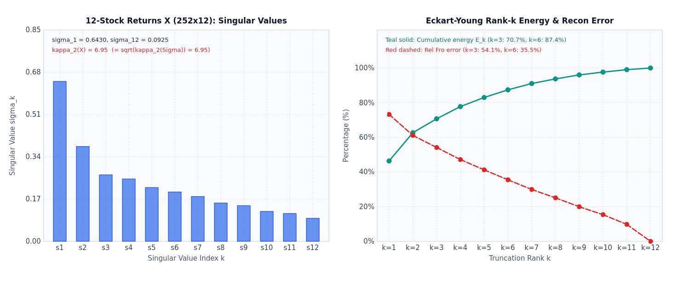

# 第五/六章联动精修专题：矩阵范数、条件数与奇异值分解（SVD）

> **对应课程范围**：第五章（`Lec6.pdf` p.10–16，Meyer §5.1–5.2）与第六章（`Lec7.pdf` p.50–57，Meyer §5.12）。本专题与主修章[第八章修订稿](chapter8_eigenvalues_and_psd_revised.md)及题目二量化组合风控形成完整理论闭环。

---

## 一、诱导矩阵范数、次可乘性与谱范数推导（对应 `Lec6` p.10–16）

### 1.1 为什么矩阵范数必须满足次可乘性？

`Lec6` p.11 指出，方阵空间 $\mathbb{C}^{n\times n}$（以及维度相容的矩形矩阵乘法族）不仅是向量空间，还具有乘法代数结构，因此一般矩阵范数除正定性、齐次性与三角不等式外，还要求**次可乘性（submultiplicativity）**：$\|AB\| \le \|A\|\|B\|$。

> **【增补-推导】诱导矩阵范数必然满足相容性与次可乘性**  
> 设 $\|\cdot\|_v$ 为任意向量范数，定义诱导（算子）矩阵范数：
> $$\|A\| = \max_{\|x\|_v = 1} \|Ax\|_v = \max_{x\neq 0} \frac{\|Ax\|_v}{\|x\|_v}.$$
> - **与向量范数相容**：对非零 $x$，$\|Ax\|_v = \|x\|_v \cdot \|A(x/\|x\|_v)\|_v \le \|A\|\|x\|_v$（$x=0$ 平凡成立）。  
> - **次可乘性**：对任意 $\|x\|_v = 1$，$\|(AB)x\|_v = \|A(Bx)\|_v \le \|A\|\|Bx\|_v \le \|A\|\|B\|\|x\|_v = \|A\|\|B\|$，对所有单位向量取极大即得 $\|AB\| \le \|A\|\|B\|$。$\blacksquare$  
> - **谱范数 $\|A\|_2 = \sqrt{\lambda_{\max}(A^*A)} = \sigma_1(A)$**：因为 $A^*A$ 是 Hermite 半正定阵，由第八章 **Rayleigh–Ritz 定理**（定理 8.4）：
>   $$\|A\|_2^2 = \max_{\|x\|_2=1} \|Ax\|_2^2 = \max_{\|x\|_2=1} \frac{x^*(A^*A)x}{x^*x} = \lambda_{\max}(A^*A) = \sigma_1(A)^2.$$
>   同理，若 $A$ 非奇异，则 $\min_{\|x\|_2=1}\|Ax\|_2 = \sqrt{\lambda_{\min}(A^*A)} = \sigma_n(A) = 1/\|A^{-1}\|_2$，这就将 `Lec6` p.13–14 的范数公式与第八章的 Rayleigh 商彻底打通。参考：Meyer §5.2 (p.279–282)；Horn & Johnson (2013) §5.6。

---

## 二、条件数与线性系统扰动界（对应 `Lec7` p.52–54）

设非奇异系统 $Ax = b$（$b\neq 0$，故 $x\neq 0$）存在右端扰动 $A(x+\Delta x) = b + \Delta b$（即 $A\Delta x = \Delta b$）。由相容性得 $\|\Delta x\| = \|A^{-1}\Delta b\| \le \|A^{-1}\|\|\Delta b\|$ 与 $\|b\| = \|Ax\| \le \|A\|\|x\|$，两式相乘即得相对误差放大上界：

$$\frac{\|\Delta x\|}{\|x\|} \le \|A\|\|A^{-1}\| \cdot \frac{\|\Delta b\|}{\|b\|} = \kappa(A)\frac{\|\Delta b\|}{\|b\|}.$$

> **【增补-知识关联（联动题目二组合权重稳定性与病态扰动实算）】**  
> 1. **数值算例（$0.5\%$ 误差放大 $199\times$）**：考察两只高度相关资产的相关矩阵 $\Sigma_{\text{ill}} = \begin{pmatrix} 1 & 0.99 \\ 0.99 & 1 \end{pmatrix}$，其特征值为 $1.99$ 与 $0.01$，故 $\kappa_2(\Sigma_{\text{ill}}) = 199$。对线性系统 $\Sigma_{\text{ill}} z = (1, 1)^T$ 施加仅 $0.5\%$ 相对大小的反相扰动 $\Delta b = (0.005, -0.005)^T$（$\|\Delta b\|_2/\|b\|_2 = 0.005$），解向量相对漂移高达 **$\|\Delta z\|_2/\|z\|_2 = 0.995 = 99.5\%$**，精确触发了上界放大倍数 `199×`（已由 `verify_manuscript_math.py` 校验）。
> 2. **为何 Gram 阵会让条件数平方恶化**：在题目二的无约束最小方差闭式解 $w^* = \frac{\Sigma^{-1}\mathbf{1}}{\mathbf{1}^T \Sigma^{-1}\mathbf{1}}$ 中，核心是解线性系统 $\Sigma z = \mathbf{1}$，其中 $\Sigma = \frac{252}{T-1} X^T X$。由于 $\sigma_i(X^T X) = \sigma_i(X)^2$，有严格恒等式 **$\kappa_2(\Sigma) = \kappa_2(X)^2$**！在 12 只美股真实日收益率矩阵上，$\kappa_2(X) = 6.95$，形成协方差阵后直接平方放大至 $\kappa_2(\Sigma) = 48.30$；这正是 Ledoit–Wolf 谱收缩 $\Sigma_\alpha = (1-\alpha)\Sigma + \alpha\mu I$ 将条件数从 `48.30` 压低至 `30.78`、并显著降低样本外换手率的根本线性代数机制。

---

## 三、SVD、Eckart–Young–Mirsky 最佳低秩逼近与现代大模型应用（对应 `Lec7` p.50–57 & `Lec0`）

设 $A \in \mathbb{C}^{m\times n}$ 秩为 $r$，奇异值分解为 $A = U \Sigma V^* = \sum_{i=1}^r \sigma_i u_i v_i^*$（$\sigma_1 \ge \cdots \ge \sigma_r > 0$）。对任意 $1 \le k < r$，定义截断 SVD 矩阵 $A_k = \sum_{i=1}^k \sigma_i u_i v_i^*$。

> **【增补-推导】补全 `Lec7` p.55–56 省略的 Eckart–Young–Mirsky 定理（2-范数与 Frobenius 范数）严格证明**  
> **定理（Eckart–Young–Mirsky，1936/1960）**：对一切满足 $\mathrm{rank}(B)\le k$ 的矩阵 $B\in\mathbb{C}^{m\times n}$，恒有：
> $$\|A - B\|_2 \ge \|A - A_k\|_2 = \sigma_{k+1}, \qquad \|A - B\|_F \ge \|A - A_k\|_F = \sqrt{\sum_{i=k+1}^r \sigma_i^2}.$$
> **2-范数证明**：首先 $A - A_k = \sum_{i=k+1}^r \sigma_i u_i v_i^*$ 的最大奇异值为 $\sigma_{k+1}$，故 $\|A - A_k\|_2 = \sigma_{k+1}$。下证任意 $\mathrm{rank}(B)\le k$ 均有 $\|A-B\|_2\ge \sigma_{k+1}$：由秩-零化度定理，$\dim N(B) = n - \mathrm{rank}(B) \ge n - k$；令 $\mathcal{V}_{k+1} = \mathrm{span}\{v_1,\dots,v_{k+1}\}$（维数 $k+1$）。因为 $\dim N(B) + \dim \mathcal{V}_{k+1} \ge n + 1 > n$，故必存在单位向量 $x \in N(B)\cap \mathcal{V}_{k+1}$。写 $x = \sum_{i=1}^{k+1} c_i v_i$（$\sum |c_i|^2 = 1$），则 $Bx = 0$ 且：
> $$\|A - B\|_2^2 \ge \|(A-B)x\|_2^2 = \|Ax\|_2^2 = \left\|\sum_{i=1}^{k+1} \sigma_i c_i u_i\right\|_2^2 = \sum_{i=1}^{k+1} \sigma_i^2 |c_i|^2 \ge \sigma_{k+1}^2 \sum_{i=1}^{k+1}|c_i|^2 = \sigma_{k+1}^2. \quad \blacksquare$$
> **Frobenius 范数自洽证明（直接由 2-范数结论推得）**：对每个 $i=1,\dots,r-k$，令 $(A-B)_{i-1}$ 为 $A-B$ 的秩 $(i-1)$ 截断 SVD，则 $\mathrm{rank}\big(B + (A-B)_{i-1}\big) \le k + i - 1$。直接应用已证的 2-范数最佳低秩界即得：
> $$\sigma_i(A-B) = \|(A-B)-(A-B)_{i-1}\|_2 = \big\|A - \big(B+(A-B)_{i-1}\big)\big\|_2 \ge \sigma_{k+i}(A).$$
> 将上式平方求和即得 $\|A-B\|_F^2 = \sum_{i=1}^{\min(m,n)} \sigma_i(A-B)^2 \ge \sum_{i=1}^{r-k}\sigma_{k+i}(A)^2 = \sum_{t=k+1}^r \sigma_t^2 = \|A-A_k\|_F^2$。$\blacksquare$  
> 参考：Golub & Van Loan (2013) Theorem 2.4.8；Strang (2019) §I.8–I.9；Meyer §5.12 (p.417–418，2-范数情形)；Goodfellow et al. (2016) §2.8。

> **【增补-现代应用】SVD 低秩逼近在图像压缩、推荐系统与大语言模型中的统一视角（衔接 `Lec0` p.12, p.16, p.24）**
> 1. **图像压缩（`Lec0` p.12）**：$500\times 500$ 灰度图像矩阵取前 $k$ 阶截断 SVD，存储量由 $mn$ 降至 $k(m+n+1)$，压缩比 $5\text{–}12.5\times$ 时因奇异值快速衰减仍能保持清晰轮廓；
> 2. **推荐系统矩阵分解（`Lec0` p.16）**：评分矩阵 $R \approx P Q^T$ 本质是带观测缺失与 $L_2$ 正则化的低秩分解；
> 3. **大语言模型微调（LoRA）与推理压缩（DeepSeek-V3 MLA，`Lec0` p.24）**：LoRA 将权重更新量参数化为低秩矩阵 $\Delta W = B A$（秩 $r \ll \min(d_{\text{in}}, d_{\text{out}})$）；DeepSeek-V3 的多头潜在注意力（MLA）将高维 Key-Value 矩阵联合低秩投影到紧凑潜向量 $c_t^{KV}$ 缓存，再在推理时升维恢复，本质上都是利用权重/特征矩阵的近似低秩结构换取数量级的显存与带宽节省。

---

## 四、真实美股收益率矩阵的 SVD 谱衰减与 Eckart–Young 低秩重构实测（联动题目二）

为将本章抽象的奇异值谱、条件数平方效应与 Eckart–Young–Mirsky 最佳低秩逼近定理落地到真实数据，我们对题目二 `data/prices.csv` 中 12 只美股在 `2025-01-27` 之前 $T=252$ 个交易日的去均值日收益率矩阵 $X \in \mathbb{R}^{252\times 12}$ 直接执行瘦奇异值分解 $X = U \Sigma V^T$（全量指标经 [verify_manuscript_math.py](verify_manuscript_math.py) 自动校验）：

- **奇异值分布与条件数平方律**：前四大奇异值为 $\sigma_1 = 0.6430$、$\sigma_2 = 0.3812$、$\sigma_3 = 0.2675$、$\sigma_4 = 0.2509$，最小奇异值 $\sigma_{12} = 0.0925$。数据矩阵条件数 $\kappa_2(X) = \sigma_1/\sigma_{12} = 6.9497$，其平方 $6.9497^2 = 48.2986$ 与第八章中样本协方差阵 $\Sigma = \frac{252}{251} X^T X$ 的谱条件数 $\kappa_2(\Sigma) = 48.30$ 精确一致。
- **Eckart–Young–Mirsky 定理逐秩实测对照**：

| 截断秩 $k$ | 累计 Frobenius 能量 $E_k = \frac{\sum_{i=1}^k \sigma_i^2}{\|X\|_F^2}$ | 实测相对 Frobenius 误差 $\frac{\|X-X_k\|_F}{\|X\|_F}$ | 实测 2-范数误差 $\|X-X_k\|_2$（严格等于 $\sigma_{k+1}$） | 金融因子解释 |
|---:|---:|---:|---:|---|
| `k = 1` | `46.36%` | `73.24%` | `0.381233` | 单一市场公共波动因子（领头科技股高弹性主导） |
| `k = 3` | `70.69%` | `54.14%` | `0.250927` | 市场 + 科技成长/防御价值 + 行业分化（仅 25% 维度保留超七成能量） |
| `k = 6` | `87.41%` | `35.49%` | `0.180109` | 半秩压缩即可捕获 87.4% 收益率总平方能量，过滤尾部特质噪声 |

  
*图 6.1：题目二真实 12 只美股去均值日收益率矩阵 $X\in\mathbb{R}^{252\times 12}$（`2025-01-27`）的奇异值谱衰减与 $\kappa_2(X)^2=\kappa_2(\Sigma)$ 验证（左），以及 Eckart–Young–Mirsky 截断秩 $k$ 累计能量与相对 Frobenius 重构误差曲线（右，由 `verify_manuscript_math.py` 自动绘制）。*
