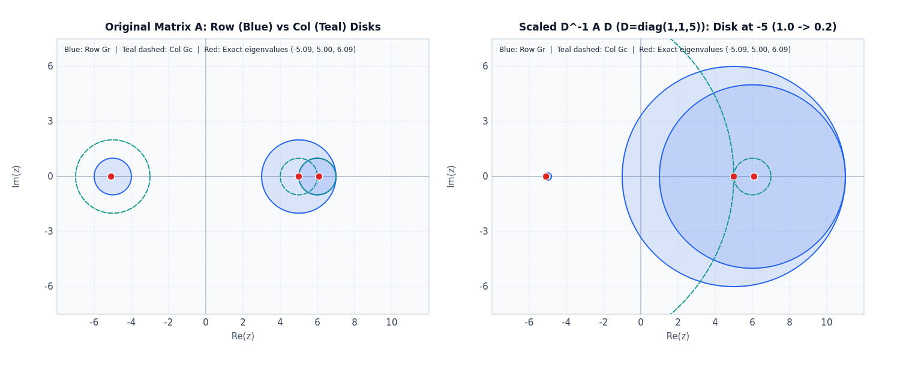
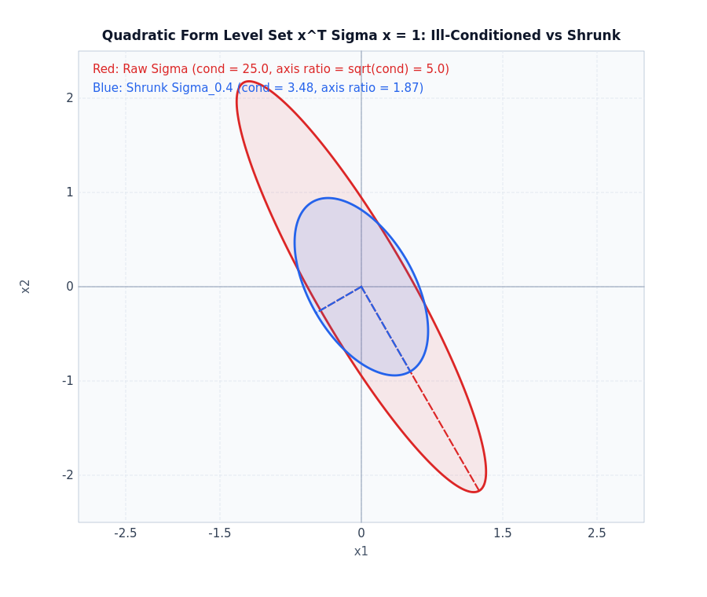
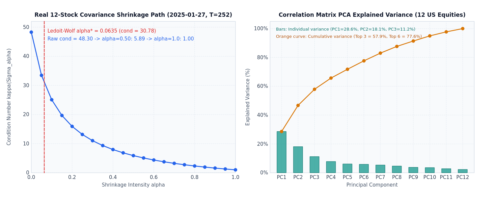

# 第八章 特征值、特征向量与正定矩阵（中文精修书稿）

> **对应课程范围**：中国科学院大学《矩阵分析与应用》第八章（对应 `Lec9.pdf`，主教材 Carl D. Meyer *Matrix Analysis and Applied Linear Algebra* 第 7 章 `7.1`、`7.2`、`7.5`、`7.6` 节）。  
> **修订标注规范**：本书稿严格保留原教材与课件的知识主干，对增补或修订内容统一采用 `【增补-背景】`、`【增补-推导】`、`【增补-几何直观】`、`【增补-勘误与辨析】`、`【增补-现代应用】` 与 `【增补-知识关联】` 显式标识；逐条修改明细与权威参考来源见同目录 [revision_notes.md](revision_notes.md)，全部算例、反例与 10 道课后习题均已通过 [verify_manuscript_math.py](verify_manuscript_math.py) 自动化验算。

---

## 8.1 特征系统的基本性质、谱半径与 Gerschgorin 圆盘

### 8.1.1 从线性微分/差分方程引出特征问题

在此前各章（第一章至第七章）中，矩阵分析的核心线索主要围绕线性代数方程组 $Ax=b$ 展开。从本章开始，研究重心转向描述状态演化的**线性动力系统**——连续时间常微分方程组 $u'(t) = Au(t)$ 与离散时间差分方程 $x_{k+1} = Ax_k$。

考虑二阶耦合微分方程组（`Lec9` p.2–3；Meyer §7.1, p.489）：

$$\begin{cases} u_1'(t) = 7u_1(t) - 4u_2(t), \\ u_2'(t) = 5u_1(t) - 2u_2(t), \end{cases} \qquad \text{即 } u'(t) = Au(t), \quad A = \begin{pmatrix} 7 & -4 \\ 5 & -2 \end{pmatrix}.$$

类比标量方程 $u' = \lambda u$ 的指数解 $u(t) = \alpha e^{\lambda t}$，令 $u(t) = x e^{\lambda t}$（其中 $x = (\alpha_1, \alpha_2)^T \neq 0$ 为常向量），求导代入即得代数特征值方程：

$$Ax = \lambda x \iff (A - \lambda I)x = 0.$$

> **【增补-背景】为何特征分解能“解耦”动力系统？**  
> 在原坐标系下，$u_1$ 与 $u_2$ 相互耦合；若能找到一组由特征向量构成的新基，将初值 $u(0) = c_1 x_1 + c_2 x_2$ 展开，则系统在各特征方向上完全独立演化：$u(t) = c_1 e^{\lambda_1 t} x_1 + c_2 e^{\lambda_2 t} x_2$。对于上述 $A$，易算得 $\det(A-\lambda I) = \lambda^2 - 5\lambda + 6 = (\lambda-2)(\lambda-3)=0$，对应特征对 $(2, (4,5)^T)$ 与 $(3, (1,1)^T)$，从而直接得到系统通解。同样地，对离散迭代 $x_k = A^k x_0$（如 Markov 链状态转移、Google PageRank 迭代 `Lec0` p.15、循环神经网络隐藏状态演化），特征值的模长决定了系统随时间是收敛、振荡还是发散。参考：Meyer §7.1 (p.489–491)；Strang (2019) §I.6。

### 8.1.2 特征值、特征空间、特征多项式与数值求解现实

**定义 8.1（特征对、谱与左右特征向量）**  
设 $A \in \mathbb{C}^{n\times n}$。若存在标量 $\lambda \in \mathbb{C}$ 与非零列向量 $x \in \mathbb{C}^n$ 满足 $Ax = \lambda x$，则称 $(\lambda, x)$ 为 $A$ 的一个**特征对（eigenpair）**，$\lambda$ 为特征值，$x$ 为（右）特征向量。$A$ 的所有互异特征值构成的集合记为 $\sigma(A)$，称为 $A$ 的**谱（spectrum）**；零空间 $N(A-\lambda I)$ 称为对应于 $\lambda$ 的**特征空间（eigenspace）**。若非零行向量 $y^*$ 满足 $y^*(A-\lambda I)=0$，则称 $y^*$ 为 $A$ 的**左特征向量**。

> **【增补-几何直观】实特征值与复特征值的几何差异**  
> `Lec9` p.4 指出：当 $A \in \mathbb{R}^{n\times n}$ 有实特征对 $(\lambda, x)$ 时，变换 $A$ 沿 $x$ 所在直线只做伸缩或反向（伸缩因子为 $\lambda$）。但当实矩阵 $A$ 出现共轭复特征值 $\lambda = a \pm bi$（$b\neq 0$，例如 `Lec9` p.5 中的 $A=\begin{pmatrix}1&-1\\1&1\end{pmatrix}$，$\sigma(A)=\{1\pm i\}$）时，实空间 $\mathbb{R}^2$ 中不存在任何不变直线——其几何作用是**旋转与缩放的复合**：记 $\lambda = r e^{\pm i\theta}$（该例中 $r=\sqrt{2},\theta=\pi/4$）及对应复特征向量 $v$，则 $A$ 在对应二维实不变子空间上的实基 $\{\mathrm{Re}(v), \mathrm{Im}(v)\}$ 下相似于旋转角 $\theta$ 再按比例 $r$ 伸缩（当 $A$ 为正规矩阵如本例时，在标准欧氏正交基下即为刚体旋转加均匀缩放）。参考：Strang (2019) §I.6；Meyer §7.1 (p.492–493)。

**定理 8.1（特征多项式系数与主子式关系）**  
设 $A \in \mathbb{C}^{n\times n}$ 的首一特征方程为 $\det(\lambda I - A) = \lambda^n + c_1 \lambda^{n-1} + \cdots + c_{n-1}\lambda + c_n = 0$，特征值为 $\lambda_1,\dots,\lambda_n$（计重数），$s_k = \sum_{1\le i_1 < \cdots < i_k \le n} \lambda_{i_1}\cdots\lambda_{i_k}$ 为第 $k$ 阶初等对称多项式，则：

$$c_k = (-1)^k s_k = (-1)^k \sum (\text{所有 } k\times k \text{ 主子式}), \quad \mathrm{tr}(A) = \sum_{i=1}^n \lambda_i = -c_1, \quad \det(A) = \prod_{i=1}^n \lambda_i = (-1)^n c_n.$$

> **【增补-背景与推导】从 Abel–Ruffini 定理到实用 QR 迭代算法**  
> `Lec9` p.6 指出 $n\ge 5$ 次一般多项式无根式求根公式，因此实用特征值计算必须依赖迭代法。值得补充两个关键事实：
> 1. **问题等价性（伴随矩阵）**：任意首一多项式 $p(\lambda) = \lambda^n + a_{n-1}\lambda^{n-1} + \cdots + a_0$ 都是其**伴随矩阵（companion matrix）** $C(p)$ 的特征多项式，因此“求一般矩阵特征值”与“求一般高次多项式根”在代数上完全等价，受 Abel–Ruffini 定理（1824）制约，不存在有限次四则运算加开方的通用精确算法；
> 2. **数值灾难警示**：即便先算出特征多项式系数再数值求根，也极不稳定——经典 **Wilkinson 多项式** $w(\lambda)=\prod_{k=1}^{20}(\lambda-k)$ 在 $\lambda^{19}$ 系数上仅加 $2^{-23}$ 的微小扰动，就会导致多个实根剧烈分裂为复根！因此现代数值线性代数（LAPACK / NumPy `eig`）从不显式展开特征多项式，而是先用 Householder 变换将 $A$ 正交相似约化为上 Hessenberg 阵（对称阵为三对角阵），再运行带位移的 **Francis 隐式 QR 迭代**直接逼近 Schur 型。参考：Golub & Van Loan (2013) §7.3–7.5；Meyer §7.1 (p.493)。

### 8.1.3 谱半径与 Gerschgorin 圆盘定理

**定义 8.2（谱半径）**  
方阵 $A \in \mathbb{C}^{n\times n}$ 的谱半径定义为 $\rho(A) = \max_{\lambda \in \sigma(A)} |\lambda|$。

> **【增补-推导】补全 `Lec9` p.10 跳过的两个基础命题证明**
>
> **命题 8.1（谱半径的范数上界）**：对任意满足次可乘性（$\|AB\|\le \|A\|\|B\|$）的矩阵范数 $\|\cdot\|$，恒有 $\rho(A) \le \|A\|$。  
> **证明**：设 $(\lambda, x)$ 是满足 $|\lambda|=\rho(A)$ 的特征对（$x\neq 0$）。构造以 $x$ 为每列的 $n\times n$ 矩阵 $X = [x, x, \dots, x] \neq 0$，则 $AX = [Ax,\dots,Ax] = \lambda X$。两边取矩阵范数并利用次可乘性：
> $$|\lambda|\|X\| = \|\lambda X\| = \|AX\| \le \|A\|\|X\|.$$
> 由于 $X\neq 0$，故 $\|X\|>0$，消去 $\|X\|$ 即得 $\rho(A) = |\lambda| \le \|A\|$。$\blacksquare$  
> *注*：必须强调该证明依赖矩阵范数的**次可乘性**（例如逐元素最大值 $\max_{i,j}|a_{ij}|$ 不是相容矩阵范数，对 $A=\begin{pmatrix}1&1\\1&1\end{pmatrix}$ 有 $\rho(A)=2 > 1=\max|a_{ij}|$）。进一步地，**Gelfand 谱半径公式**指出：对任意矩阵范数，均有 $\rho(A) = \lim_{k\to\infty}\|A^k\|^{1/k}$，且 $A^k \to 0 \iff \rho(A) < 1$。参考：Horn & Johnson (2013) Theorem 5.6.9, Theorem 5.6.12 & Corollary 5.6.14。
>
> **命题 8.2（Gerschgorin 圆盘第一定理证明）**：设 $A=(a_{ij})\in\mathbb{C}^{n\times n}$，令 $r_i = \sum_{j\neq i}|a_{ij}|$，则 $\sigma(A) \subseteq \mathcal{G}_r = \bigcup_{i=1}^n \{z\in\mathbb{C} : |z - a_{ii}| \le r_i\}$。  
> **证明**：任取特征对 $(\lambda, x)$（$x\neq 0$），记 $x$ 中模长最大的分量为 $|x_p| = \|x\|_\infty > 0$。考察 $Ax=\lambda x$ 的第 $p$ 个分量：
> $$(\lambda - a_{pp}) x_p = \sum_{j\neq p} a_{pj} x_j.$$
> 两边取绝对值并用三角不等式除以 $|x_p|$：
> $$|\lambda - a_{pp}| \le \sum_{j\neq p} |a_{pj}| \frac{|x_j|}{|x_p|} \le \sum_{j\neq p} |a_{pj}| = r_p,$$
> 故 $\lambda$ 必落入第 $p$ 个行圆盘内。对 $A^T$ 应用同一结论（因 $\sigma(A^T)=\sigma(A)$）即得列圆盘 $\mathcal{G}_c$，从而 $\sigma(A) \subseteq \mathcal{G}_r \cap \mathcal{G}_c$。$\blacksquare$

> **【增补-例子与几何直观】对角相似缩放收紧 Gerschgorin 圆盘（深化 `Lec9` p.11 例题）**  
> 考察 `Lec9` p.11 矩阵 $A = \begin{pmatrix} 5 & 1 & 1 \\ 0 & 6 & 1 \\ 1 & 0 & -5 \end{pmatrix}$。原矩阵在 $-5$ 处的行圆盘半径为 $r_3 = 1$（即 $[-6,-4]$）。因为相似变换不改变特征值，令对角缩放阵 $D = \mathrm{diag}(1, 1, 5)$，计算相似矩阵：
> $$D^{-1}AD = \begin{pmatrix} 5 & 1 & 5 \\ 0 & 6 & 5 \\ 0.2 & 0 & -5 \end{pmatrix}.$$
> 此时第 3 个行圆盘中心仍为 $-5$，半径瞬间从 $1$ 收缩 5 倍至 **$r_3' = 0.2$**，且与其他两个复平面行圆盘 $\{|z-5|\le 6\}$、$\{|z-6|\le 5\}$（实轴截距分别为 $[-1, 11]$、$[1, 11]$）完全隔离！由 Gerschgorin 连通分支定理，孤立复圆盘 $\{|z+5|\le 0.2\}$ 内恰含唯一特征值；又因 $A$ 为实矩阵、非实特征值必共轭成对出现，故该孤立特征值必为实数，从而精确落于实区间 $[-5.2, -4.8]$ 内。经 `verify_manuscript_math.py` 数值验证，$A$ 的精确特征值为 $\{-5.090170,\; 5.000000,\; 6.090170\}$，完美落于收紧后的区间内（见图 8.1）。参考：Horn & Johnson (2013) §6.1, Corollary 6.1.6；Meyer §7.1 (p.498–499)。

  
*图 8.1：`Lec9` p.11 矩阵的原始 Gerschgorin 行/列圆盘（左）与经 $D=\mathrm{diag}(1,1,5)$ 相似缩放后在 $-5$ 处收紧 5 倍的圆盘及精确特征值（右，由 `verify_manuscript_math.py` 自动绘制）。*

> **【增补-现代应用与数值验算】Google PageRank 迭代与幂法收敛率（呼应 `Lec0` p.15）**  
> 构造 4 节点有向网页图的列随机转移矩阵 $P = \begin{pmatrix} 0 & 0 & 1 & 0.5 \\ 0.5 & 0 & 0 & 0 \\ 0.5 & 1 & 0 & 0.5 \\ 0 & 0 & 0 & 0 \end{pmatrix}$ 与阻尼系数 $d=0.85$ 的 Google 矩阵 $G = dP + \frac{1-d}{4}\mathbf{1}\mathbf{1}^T$。因 $G>0$ 且列和为 $1$，由 Gerschgorin 列圆盘与 Perron–Frobenius 定理立得主特征值 $\rho(G)=\lambda_1=1$，且次主特征值模长严格受阻尼系数约束（$|\lambda_2|\le d$）。经 `verify_manuscript_math.py` 实测：
> - $G$ 的特征值模长为 $\{1.000000,\; 0.601041,\; 0.601041,\; 0\}$（恰有 $|\lambda_2|=0.85/\sqrt{2}\approx 0.601041 < 0.85$）；
> - 唯一平稳 PageRank 分布为 $\pi^* = (0.3797,\; 0.1989,\; 0.3839,\; 0.0375)^T$（节点 3 与节点 1 获最高权威分）；
> - 从均匀分布 $x^{(0)}=\frac{1}{4}\mathbf{1}$ 出发做幂迭代 $x^{(k+1)}=Gx^{(k)}$，$L_1$ 误差 $\|x^{(k)}-\pi^*\|_1$ 以几何速率 $|\lambda_2|^k$ 衰减：$k=1$ 时 `0.1572` → $k=5$ 时 `0.0205` → $k=10$ 时 `0.00228` → $k=20$ 时已降至 **`1.2e-5`**。这直观说明阻尼因子 $d=0.85$ 本质上是在“保留原始链接拓扑”与“压低 $|\lambda_2|$ 加速幂迭代收敛”之间做谱权衡。参考：Meyer §7.10；Strang (2019) §I.6。

---

## 8.2 相似对角化、Schur 三角化与谱投影分解

### 8.2.1 相似不变量与可对角化充要条件

设 $A, B \in \mathbb{C}^{n\times n}$。若存在非奇异矩阵 $P$ 使得 $P^{-1}AP = B$，则称 $A$ 与 $B$ **相似**（反映同一线性算子在不同基下的矩阵表示）。相似变换保持特征多项式、特征值（含代数/几何重数）、迹、行列式与秩不变（注意初等行变换**不**保持特征值！）。

**定理 8.2（可对角化等价刻画，`Lec9` p.13–21；Meyer §7.2, p.507–518）**  
设 $A \in \mathbb{C}^{n\times n}$ 的互异特征值为 $\sigma(A) = \{\lambda_1, \dots, \lambda_k\}$，以下四条等价：
1. $A$ 可对角化，即存在非奇异 $P$ 使 $P^{-1}AP = D$ 为对角阵；
2. $A$ 拥有 $n$ 个线性无关的特征向量；
3. 每个特征值都是**半单的（semisimple）**，即几何重数等于代数重数：$g_A(\lambda_i) \triangleq \dim N(A-\lambda_i I) = a_A(\lambda_i)$；
4. $A$ 存在**谱分解** $A = \sum_{i=1}^k \lambda_i G_i$，其中 $G_i$ 为沿 $R(A-\lambda_i I)$ 到 $N(A-\lambda_i I)$ 的投影算子，满足 $G_i^2 = G_i$、$G_i G_j = 0$ ($i\neq j$) 与 $\sum_{i=1}^k G_i = I$。

> **【增补-推导】补全 `Lec9` p.15–21 跳过的三大核心定理证明**
>
> **（1）Schur 酉三角化定理（1909）的数学归纳证明**（`Lec9` p.15 仅陈述结论，此处补全完整证明，并显式衔接第五章/Lec6 的酉基扩充）：  
> **定理**：任意 $A \in \mathbb{C}^{n\times n}$ 都存在酉矩阵 $U$ 与上三角矩阵 $T$，使 $U^* A U = T$，且 $T$ 的主对角元恰为 $A$ 的特征值。  
> **证明**：对阶数 $n$ 归纳。$n=1$ 时显然成立。设对 $n-1$ 阶成立。由代数基本定理，$A$ 至少存在一个特征对 $(\lambda_1, u_1)$，不妨归一化 $\|u_1\|_2 = 1$。利用第五章（`Lec6` p.48）的 Householder 反射或 Gram-Schmidt 扩充，将 $u_1$ 扩充为 $\mathbb{C}^n$ 的标准正交基，构成酉矩阵 $U_1 = [u_1 \mid V_1]$。计算：
> $$U_1^* A U_1 = \begin{pmatrix} u_1^* \\ V_1^* \end{pmatrix} [A u_1 \mid A V_1] = \begin{pmatrix} \lambda_1 & u_1^* A V_1 \\ 0 & V_1^* A V_1 \end{pmatrix} = \begin{pmatrix} \lambda_1 & b^* \\ 0 & \tilde{A} \end{pmatrix},$$
> 其中利用了 $V_1^* u_1 = 0$。对 $(n-1)\times(n-1)$ 矩阵 $\tilde{A}$ 应用归纳假设，存在 $(n-1)$ 阶酉矩阵 $\tilde{U}$ 使 $\tilde{U}^*\tilde{A}\tilde{U} = \tilde{T}$ 为上三角阵。令 $U = U_1 \begin{pmatrix} 1 & 0 \\ 0 & \tilde{U} \end{pmatrix}$，显然 $U$ 仍为酉矩阵，且
> $$U^* A U = \begin{pmatrix} \lambda_1 & b^* \tilde{U} \\ 0 & \tilde{T} \end{pmatrix} \triangleq T$$
> 为上三角阵。由于酉相似保持特征值，故 $T$ 的主对角元恰为 $A$ 的全部特征值。$\blacksquare$  
> *工程意义*：相比非酉相似 $P^{-1}AP$（当特征向量近乎共线时 $\kappa(P)$ 极大、数值崩溃），Schur 变换的酉矩阵 $U$ 满足 $\kappa_2(U)=1$，绝对保范且数值无条件稳定！
>
> **（2）重数不等式 $g_A(\lambda) \le a_A(\lambda)$ 的分块证明**（`Lec9` p.17 仅给结论）：  
> 设 $g = \dim N(A-\lambda I)$，取 $N(A-\lambda I)$ 的一组基 $X_1 \in \mathbb{C}^{n\times g}$，扩充为全空间基 $P = [X_1 \mid X_2]$。则 $A X_1 = \lambda X_1$，故 $P^{-1}AP = \begin{pmatrix} \lambda I_g & B \\ 0 & C \end{pmatrix}$。由分块上三角行列式公式（参见习题 4），
> $$\det(xI - A) = \det(xI - P^{-1}AP) = (x-\lambda)^g \det(xI - C).$$
> 这表明 $(x-\lambda)^g$ 整除特征多项式，故 $a_A(\lambda) \ge g = g_A(\lambda)$。$\blacksquare$
>
> **（3）谱投影算子的 Lagrange 插值闭式推导**（`Lec9` p.21 直接给出公式）：  
> 由 $A = \sum_{r=1}^k \lambda_r G_r$ 及 $G_r G_s = \delta_{rs} G_r$、$\sum_{r=1}^k G_r = I$，对任意多项式 $f(x)$ 均有 $f(A) = \sum_{r=1}^k f(\lambda_r) G_r$。选取第 $i$ 个 Lagrange 基多项式 $\ell_i(x) = \prod_{j\neq i} \frac{x - \lambda_j}{\lambda_i - \lambda_j}$，它满足 $\ell_i(\lambda_r) = \delta_{ir}$，代入即得：
> $$G_i = \ell_i(A) = \frac{\prod_{j\neq i}(A - \lambda_j I)}{\prod_{j\neq i}(\lambda_i - \lambda_j)} \quad (k\ge 2;\; \text{当 } k=1 \text{ 即 } A=\lambda_1 I \text{ 时 } G_1=I). \quad \blacksquare$$
> 更一般地，对任意在谱 $\sigma(A)$ 上有定义（解析）的函数（如矩阵指数 $e^{At}$），只要 $A$ 可对角化，便立得 $f(A) = \sum_{i=1}^k f(\lambda_i) G_i$，从而无需显式求 $P^{-1}$ 即可直接写出微分方程解 $u(t) = e^{At}u(0) = \sum_{i=1}^k e^{\lambda_i t} G_i u(0)$。参考：Meyer §7.2–7.3 (p.508–529)；Horn & Johnson (2013) Theorem 2.3.1。

> **【增补-知识关联】亏损矩阵与 Jordan 标准形的衔接**  
> 当存在某个特征值满足 $g_A(\lambda) < a_A(\lambda)$ 时（如 `Lec9` p.8–9 的矩阵与 p.18 的矩阵 $A$），矩阵称为**亏损矩阵（defective matrix）**，无法对角化，但可经非酉相似化为几乎对角的 **Jordan 标准形** $P^{-1}AP = J = \mathrm{diag}(J_1,\dots,J_m)$，每个 Jordan 块 $J_r = \lambda_r I + N_r$ 拆分为标量对角阵与幂零阵 $N_r$ 之和，从而将幂次与矩阵指数推广至一般方阵（对应 Meyer §7.7–7.9）。

---

## 8.3 正规矩阵、Hermite 矩阵与谱微扰理论

### 8.3.1 酉对角化与正规矩阵

一般可对角化矩阵的变换阵 $P$ 不一定正交/酉。何时存在一组**标准正交特征基**（即 $U^*AU=D$）？

**定理 8.3（正规矩阵的酉对角化定理，`Lec9` p.22–23；Meyer §7.5, p.547）**  
$A \in \mathbb{C}^{n\times n}$ 酉相似于对角矩阵，当且仅当 $A$ 是**正规矩阵（normal matrix）**，即 $A^*A = AA^*$。

> **【增补-推导】利用 Schur 定理极简证明定理 8.3（顺带贯通 `Lec9` 习题 9）**  
> - **必要性**：若 $A = UDU^*$（$U$ 酉、$D$ 对角），则 $A^*A = UD^*DU^* = UDD^*U^* = AA^*$。  
> - **充分性**：设 $A^*A = AA^*$。由 Schur 定理存在酉阵 $U$ 使 $T = U^*AU$ 为上三角阵。因为酉相似保持正规性，$T^*T = U^*A^*AU = U^*AA^*U = TT^*$。逐行比较 $T^*T$ 与 $TT^*$ 的第 $(i,i)$ 对角元：
>   - 当 $i=1$：$(T^*T)_{11} = |t_{11}|^2$，而 $(TT^*)_{11} = |t_{11}|^2 + \sum_{j=2}^n |t_{1j}|^2$，故 $t_{12}=\cdots=t_{1n}=0$；
>   - 归纳至第 $i$ 行：前 $i-1$ 行非对角元已为零，故 $(T^*T)_{ii} = |t_{ii}|^2 = |t_{ii}|^2 + \sum_{j=i+1}^n |t_{ij}|^2$，得 $t_{i,i+1}=\cdots=t_{in}=0$。  
>   由此 $T$ 必为对角阵！这同时严格证明了 `Lec9` p.32 习题 9：“三角矩阵是正规的当且仅当它是对角阵”。$\blacksquare$  
> 常见正规矩阵家族包括：实对称阵、Hermite 阵（实特征值）、反对称/反 Hermite 阵（纯虚特征值）、正交/酉阵（特征值在单位圆上）。

### 8.3.2 补全 `Lec9` p.24 遗漏的三大 Hermite 矩阵核心定理

> **【增补-勘误与推导】修复 `Lec9` 第 24 页的重大内容缺漏！**  
> 检查原课程课件 `Lec9.pdf` 第 24 页可见，该页列出了 *"Largest and Smallest Eigenvalues"* 与 *"Eigenvalue Perturbations"* 两个小标题，却只写了前提设定句子而**漏掉了对应的核心数学不等式与证明**（见 [revision_notes.md](revision_notes.md) 勘误项 #5）。下面依据主教材 Meyer §7.5 (p.549–554) 与 Horn & Johnson (2013) 第 4 章完整补齐：

设 $A \in \mathbb{C}^{n\times n}$ 为 Hermite 矩阵（实情形即对称矩阵 $A=A^T$），其特征值按降序排列为 $\lambda_1 \ge \lambda_2 \ge \cdots \ge \lambda_n$，对应的标准正交特征向量为 $u_1,\dots,u_n$。

**定理 8.4（Rayleigh–Ritz 变分定理，Meyer p.550；Horn & Johnson Theorem 4.2.2）**  
定义非零向量 $x$ 的 **Rayleigh 商**为 $R_A(x) = \frac{x^* A x}{x^* x}$，则对一切 $x \neq 0$ 有：

$$\lambda_n \le \frac{x^* A x}{x^* x} \le \lambda_1, \qquad \lambda_1 = \max_{x\neq 0}\frac{x^*Ax}{x^*x}, \quad \lambda_n = \min_{x\neq 0}\frac{x^*Ax}{x^*x}.$$

*证明*：将 $x$ 在标准正交特征基下展开为 $x = \sum_{k=1}^n c_k u_k$，则 $x^*x = \sum_{k=1}^n |c_k|^2$ 且 $x^*Ax = \sum_{k=1}^n \lambda_k |c_k|^2$。由于 $\lambda_n \le \lambda_k \le \lambda_1$，立即得 $\lambda_n \sum |c_k|^2 \le x^*Ax \le \lambda_1 \sum |c_k|^2$，且取 $x=u_1$ 与 $x=u_n$ 时分别达到上下界。$\blacksquare$

**定理 8.5（Courant–Fischer 极小极大定理，Meyer p.550–551；Horn & Johnson Theorem 4.2.6）**  
中间特征值由子空间变分刻画：

$$\lambda_k = \max_{\dim(\mathcal{V})=k}\;\min_{0\neq x\in\mathcal{V}} \frac{x^*Ax}{x^*x} = \min_{\dim(\mathcal{W})=n-k+1}\;\max_{0\neq x\in\mathcal{W}} \frac{x^*Ax}{x^*x}, \qquad k=1,2,\dots,n.$$

*证明思路*：任取 $k$ 维子空间 $\mathcal{V}$，它与 $(n-k+1)$ 维子空间 $\mathcal{U}_k = \mathrm{span}\{u_k,\dots,u_n\}$ 的维数之和为 $n+1>n$，必有非零交向量 $x_0 \in \mathcal{V}\cap\mathcal{U}_k$；对 $x_0$ 有 $R_A(x_0)\le \lambda_k$，故 $\min_{x\in\mathcal{V}} R_A(x)\le \lambda_k$。再取 $\mathcal{V}=\mathrm{span}\{u_1,\dots,u_k\}$ 时下确界恰达 $\lambda_k$。另一式对称可证。$\blacksquare$

**定理 8.6（Weyl 特征值扰动定理，补全 `Lec9` p.24；Meyer p.551–552；Horn & Johnson Theorem 4.3.1）**  
设 $A, E \in \mathbb{C}^{n\times n}$ 均为 Hermite 矩阵，记 $B = A + E$，三者的降序特征值分别为 $\lambda_1\ge\cdots\ge\lambda_n$、$\epsilon_1\ge\cdots\ge\epsilon_n$ 与 $\beta_1\ge\cdots\ge\beta_n$，则对每个 $i=1,\dots,n$ 以及任意**次可乘**矩阵范数 $\|\cdot\|$ 均有：

$$\lambda_i + \epsilon_n \le \beta_i \le \lambda_i + \epsilon_1, \qquad \text{特别地 } |\beta_i - \lambda_i| \le \|E\|_2 \le \|E\|.$$

*证明*：由 Courant–Fischer 定理及 Rayleigh 商上界 $\frac{x^*Ex}{x^*x} \le \epsilon_1$：
$$\beta_i = \min_{\dim(\mathcal{W})=n-i+1}\max_{0\neq x\in\mathcal{W}} \left(\frac{x^*Ax}{x^*x} + \frac{x^*Ex}{x^*x}\right) \le \min_{\dim(\mathcal{W})=n-i+1}\max_{0\neq x\in\mathcal{W}} \frac{x^*Ax}{x^*x} + \epsilon_1 = \lambda_i + \epsilon_1.$$
下界同理由 $\frac{x^*Ex}{x^*x} \ge \epsilon_n$ 得证。又因 $E$ 为 Hermite 阵，故 $\max(|\epsilon_1|, |\epsilon_n|) = \rho(E) = \|E\|_2 \le \|E\|$（由命题 8.1），即得 $|\beta_i - \lambda_i| \le \|E\|_2 \le \|E\|$。$\blacksquare$  
*深刻意义*：**Hermite / 实对称矩阵的特征值是绝对良态的**——任何对称扰动 $E$ 引起的特征值漂移绝不超过 $\|E\|_2$！相比之下，非正规矩阵（如亏损 Jordan 块 $J_n(0)$ 在 $(n,1)$ 位置加 $\varepsilon$ 扰动）的特征值漂移可达 $\varepsilon^{1/n}$，对微小舍入误差极度敏感。

**定理 8.7（Cauchy 交错定理，`Lec9` p.24；Meyer p.552–553）**  
对镶边 Hermite 矩阵 $B = \begin{pmatrix} A & c \\ c^* & \alpha \end{pmatrix}$，其降序特征值 $\beta_1\ge\cdots\ge\beta_{n+1}$ 与 $A$ 的特征值 $\lambda_1\ge\cdots\ge\lambda_n$ 满足交错不等式：$\beta_1\ge\lambda_1\ge\beta_2\ge\cdots\ge\beta_n\ge\lambda_n\ge\beta_{n+1}$。*证明*：记超平面 $\mathcal{H}=\{x\in\mathbb{C}^{n+1}: x_{n+1}=0\}\cong \mathbb{C}^n$，在其上有 $R_B(x)=R_A(\tilde{x})$。在 Courant–Fischer 定理中缩小可行子空间集合立得：$\lambda_k = \max_{\dim\mathcal{V}=k,\,\mathcal{V}\subset\mathcal{H}}\min_{x\in\mathcal{V}} R_B(x) \le \max_{\dim\mathcal{V}=k}\min_{x\in\mathcal{V}} R_B(x) = \beta_k$，且 $\beta_{k+1} = \min_{\dim\mathcal{W}=n-k+1}\max_{x\in\mathcal{W}} R_B(x) \le \min_{\dim\mathcal{W}=n-k+1,\,\mathcal{W}\subset\mathcal{H}}\max_{x\in\mathcal{W}} R_B(x) = \lambda_k$。$\blacksquare$

### 8.3.3 特征值与奇异值的桥梁及现代 AI 应用

`Lec9` p.25 给出了秩为 $r$ 的矩形矩阵 $A\in\mathbb{C}^{m\times n}$ 的非零奇异值 $\sigma_1,\dots,\sigma_r$ 与 $A^*A$、$AA^*$ 以及 $(m+n)$ 阶 Jordan–Wielandt Hermite 增广矩阵 $B = \begin{pmatrix} 0 & A \\ A^* & 0 \end{pmatrix}$ 的非零特征值 $\{\pm\sigma_1,\dots,\pm\sigma_r\}$（其余 $m+n-2r$ 个特征值为 $0$）之间的精确对应（已由 `verify_manuscript_math.py` 数值验算）。

> **【增补-现代应用】从实对称谱分解到 PCA 与大模型低秩压缩（衔接 `Lec0` 与题目二）**
> 1. **主成分分析（PCA）**：给定去均值数据矩阵 $X\in\mathbb{R}^{T\times N}$，寻找单位方向 $v$ 使投影方差 $\frac{1}{T-1}\|Xv\|_2^2 = v^T \Sigma v$ 最大，这正是 **Rayleigh–Ritz 定理**在样本协方差/相关系数矩阵上的直接应用——第一主成分就是最大特征值对应的特征向量 $v_1$，第 $k$ 主成分由 Courant–Fischer 变分原理在 $\{v_1,\dots,v_{k-1}\}^\perp$ 上求得（参考：Goodfellow et al. (2016) §2.12；Strang (2019) §I.9）；
> 2. **大语言模型低秩注意力（DeepSeek-V3 MLA，`Lec0` p.24）与 LoRA**：大规模 Transformer 权重矩阵和 KV Cache 具有显著的奇异值快速衰减特性（绝大多数谱能量集中在少数前导奇异值上），通过低秩投影 $W \approx U_r \Sigma_r V_r^T$ 或潜空间压缩 $c_t^{KV} = W^{DKV} h_t$，可用极低秩维度保留主要语义信息并大幅降低推理显存占用（详见联动章节 [chapter5_6_norms_svd_supplement.md](chapter5_6_norms_svd_supplement.md)）。

---

## 8.4 正定与半正定矩阵、二次型几何与金融协方差收缩实证

### 8.4.1 正定矩阵的等价刻画与半正定矩阵的常见陷阱

**定理 8.8（实对称正定矩阵 6 条等价命题，`Lec9` p.27；Meyer §7.6, p.559）**  
设 $A \in \mathbb{R}^{n\times n}$ 为实对称矩阵，下列命题等价：
1. 对一切非零 $x\in\mathbb{R}^n$，$x^T A x > 0$；
2. $A$ 的全部特征值严格大于 $0$；
3. 存在**实**非奇异矩阵 $B\in\mathbb{R}^{n\times n}$ 使 $A = B^T B$（且存在唯一对角元为正的上三角实矩阵 $R$ 使 $A = R^T R$，称为 **Cholesky 分解**）；
4. $A$ 存在无需行交换的 $LDL^T$ 分解且所有主元 $d_i > 0$；
5. $A$ 的所有**顺序主子式（leading principal minors）** 严格为正（Sylvester 判别法）；
6. $A$ 的所有主子式严格为正。

> **【增补-勘误与辨析】纠正 `Lec9` 第 28 页关于半正定矩阵的两大常见误区**  
> 1. **误区一：“顺序主子式非负 $\Rightarrow$ 半正定”不成立！**  
>    反例：$A = \begin{pmatrix} 0 & 0 \\ 0 & -1 \end{pmatrix}$。其一阶顺序主子式 $\Delta_1 = 0 \ge 0$、二阶顺序主子式 $\Delta_2 = \det(A) = 0 \ge 0$，但特征值为 $\{0, -1\}$，显然**不是**半正定矩阵！必须对每个阶数 $k=1,\dots,n$ 检查全部 $\binom{n}{k}$ 个 $k$ 阶主子式（共计 $2^n - 1$ 个主子式）均非负（该例中第 $(2,2)$ 一阶主子式为 $-1<0$ 立即否决）。  
> 2. **误区二（修正 `Lec9` p.28 原文表述）**：`Lec9` p.28 写 *"When A has zero eigenvalues, there is no LU factorzation"*（沿袭了 Meyer p.566 将“LU 分解”限定于非奇异阵无零主元情形的口语化说法，且含拼写错 `factorzation`）。严格来说，**在精确算术下，任意对称半正定矩阵 $A$ 甚至仍存在无行交换的 $A=LDL^T$（$d_i\ge 0$，故 $A=LU$）与主对角元非负的 $A=R^TR$ 分解**——因为半正定阵在消元过程中一旦出现零主元 $s_{kk}=0$，由 $|s_{kj}|^2 \le s_{kk}s_{jj}=0$ 必强制剩余子阵的第 $k$ 行与第 $k$ 列全为零（见 Horn & Johnson Corollary 7.2.9；例如 $\mathrm{diag}(1,0) = I\cdot\mathrm{diag}(1,0)$）。真正失效的是：（a）**不存在**主对角元严格为正（非奇异）的 Cholesky 因子 $R$；（b）非负对角分解**不再唯一**；（c）浮点舍入误差会将精确零主元扰动为微小非零数引发数值崩溃，因此工程上必须采用带完全对称主元选择的秩揭示分解 $PAP^T = LDL^T$ 或 $PAP^T = R^TR$（Golub & Van Loan §4.2.8–4.2.9）。

> **【增补-例题】$3\times 3$ 实对称正定阵的 $LDL^T$、Cholesky 分解与顺序主子式对照（呼应 `Lec9` p.27–30）**  
> 考察实对称矩阵 $A = \begin{pmatrix} 4 & 2 & -2 \\ 2 & 10 & 2 \\ -2 & 2 & 6 \end{pmatrix}$：
> 1. **无行交换对称消元（$LDL^T$）**：第一主元 $d_1=4$，乘子 $l_{21}=\frac{1}{2}$、$l_{31}=-\frac{1}{2}$；消去第一行/列后 Schur 补为 $\begin{pmatrix} 9 & 3 \\ 3 & 5 \end{pmatrix}$，得第二主元 $d_2=9$、$l_{32}=\frac{1}{3}$ 及第三主元 $d_3 = 5 - 3^2/9 = 4$。所有主元 $(4,9,4)>0$，立即判定 $A$ 严格正定！
> 2. **唯一 Cholesky 上三角因子 $R = D^{1/2} L^T$**：取 $\sqrt{D}=\mathrm{diag}(2,3,2)$，立得全整数因子
>    $$L = \begin{pmatrix} 1 & 0 & 0 \\ \frac{1}{2} & 1 & 0 \\ -\frac{1}{2} & \frac{1}{3} & 1 \end{pmatrix}, \qquad R = \begin{pmatrix} 2 & 1 & -1 \\ 0 & 3 & 1 \\ 0 & 0 & 2 \end{pmatrix}, \qquad A = L D L^T = R^T R.$$
> 3. **与 Sylvester 顺序主子式精确对应**：$\Delta_1 = 4$、$\Delta_2 = 36$、$\Delta_3 = \det(A) = 144 = (\det R)^2$，严格满足主元比值公式 $d_k = \Delta_k / \Delta_{k-1}$（$4=4/1,\; 9=36/4,\; 4=144/36$），且特征值 $\{1.8277,\; 7.1440,\; 11.0283\}$ 全部为正（已由 `verify_manuscript_math.py` 校验）。

### 8.4.2 二次型的几何直观与 Sylvester 惯性定律

设 $A=A^T \in \mathbb{R}^{n\times n}$ 正定，由正交谱分解 $A = Q \Lambda Q^T$，令旋转坐标 $y = Q^T x$，则二次型等值面化为标准椭球方程：

$$x^T A x = \sum_{i=1}^n \lambda_i y_i^2 = c \quad (c>0) \iff \sum_{i=1}^n \frac{y_i^2}{(c/\lambda_i)} = 1.$$

> **【增补-几何直观】椭球扁平度与条件数 $\kappa_2(A)$ 的直接联系**  
> 等值椭球的主轴方向恰为特征向量 $q_1,\dots,q_n$，第 $i$ 根半轴长度为 $\sqrt{c/\lambda_i}$：特征值**越大**的方向半轴越**短**（曲率越陡），特征值**越小**的方向半轴越**长**（曲率越平缓）。椭球最长半轴与最短半轴之比恰为：
> $$\frac{a_{\max}}{a_{\min}} = \sqrt{\frac{\lambda_{\max}}{\lambda_{\min}}} = \sqrt{\kappa_2(A)}.$$
> 当 $A$ 病态（$\kappa_2(A)\gg 1$）时，等值面呈极度拉长的狭长“峡谷”，一方面导致梯度下降法产生剧烈“之字形”震荡，另一方面在投资组合优化中令 $A^{-1}\mathbf{1}$ 对小特征值噪声极度放大。通过线性谱收缩 $A_\alpha = (1-\alpha)A + \alpha\mu I$，椭球被显著“圆化”，数值稳定性随之大幅改善（见图 8.2）。

  
*图 8.2：病态正定矩阵（$\kappa=25$，红）与线性收缩矩阵（$\alpha=0.4$，蓝）的二次型等值椭球 $x^T \Sigma x = 1$ 及主轴对比（由 `verify_manuscript_math.py` 绘制）。*

> **【增补-推导】补全 `Lec9` 第 30 页缺失的 Sylvester 惯性定律**  
> `Lec9` p.30 指出不必求特征值、只需合同变换 $C^T A C = D$（如 $A = LDL^T$）即可将二次型对角化，但未说明为何主元 $p_i$ 的符号足以判定正定性。其理论根基是 **Sylvester 惯性定律（Law of Inertia）**：  
> **定理 8.9（Sylvester 惯性定律，Horn & Johnson Theorem 4.5.8）**：设 $A \in \mathbb{R}^{n\times n}$ 实对称，$C\in\mathbb{R}^{n\times n}$ 为**实**非奇异矩阵，则合同矩阵 $C^T A C$ 与 $A$ 具有**完全相同的正特征值个数 $n_+$、负特征值个数 $n_-$ 与零特征值个数 $n_0$**（三元组 $(n_+, n_-, n_0)$ 称为惯性指数）。  
> *证明概要*：设 $B = C^T A C$，若 $n_+(B) > n_+(A)$，则 $B$ 的正特征子空间经 $C$ 映射后与 $A$ 的非正特征子空间维数之和超过 $n$，必有非零交向量 $x = Cy$，一方面 $x^T A x \le 0$，另一方面 $x^T A x = y^T B y > 0$，矛盾！由对称性得 $n_+(A)=n_+(B)$，同理 $n_-(A)=n_-(B)$。$\blacksquare$  
> 因此，只要 $A$ 存在对角合同分解 $A = LDL^T$，其对角主元 $p_1,\dots,p_n$ 的正负零计数就**严格等于** $A$ 的特征值正负零计数，计算量仅约 $\frac{1}{3}n^3$ 次浮点运算，远低于特征分解。

### 8.4.3 贯通性实战案例：基于真实美股协方差矩阵的谱收缩、PCA 与组合优化（联动题目二）

> **【增补-现代应用（与本项目题目二 `Matrix Workbench` 深度联动）】**  
> 在金融量化组合管理中，令 $R\in\mathbb{R}^{T\times N}$ 为 $N=12$ 只美股（`AAPL, AMZN, GOOGL, JNJ, JPM, KO, META, MSFT, NVDA, PG, WMT, XOM`）在 `2025-01-27` 之前 $T=252$ 个交易日的日收益率矩阵，去均值阵为 $X$，年化样本协方差矩阵 $\Sigma = \frac{252}{T-1}X^T X$ 是典型的 **Gram 矩阵**（定理 8.8 中 $B^TB$ 形式），天然对称半正定。
>
> **定理 8.10（线性谱收缩的特征值平移与条件数单调性）**  
> 设 $\Sigma \succ 0$ 具有特征值 $\lambda_1 \ge \cdots \ge \lambda_n > 0$，定义收缩目标 $\mu = \frac{\mathrm{tr}(\Sigma)}{n} = \frac{1}{n}\sum_{i=1}^n \lambda_i$ 与收缩矩阵 $\Sigma_\alpha = (1-\alpha)\Sigma + \alpha\mu I$（$\alpha\in[0,1]$）。则：
> 1. $\Sigma_\alpha$ 与 $\Sigma$ 共享同一组正交特征向量，且第 $i$ 个特征值为 $\lambda_i(\Sigma_\alpha) = (1-\alpha)\lambda_i + \alpha\mu$；
> 2. 条件数 $\kappa_2(\Sigma_\alpha) = \frac{(1-\alpha)\lambda_1 + \alpha\mu}{(1-\alpha)\lambda_n + \alpha\mu}$ 在 $\alpha\in[0,1]$ 上关于 $\alpha$ **严格单调递减**（当 $\lambda_1>\lambda_n$ 时），且 $\kappa_2(\Sigma_1)=1$。  
> *证明*：由 $Q^T\Sigma_\alpha Q = (1-\alpha)\Lambda + \alpha\mu I$ 即得 (1)。对 $\kappa_2(\Sigma_\alpha)$ 求导，分子为 $(\mu-\lambda_1)[(1-\alpha)\lambda_n+\alpha\mu] - [(1-\alpha)\lambda_1+\alpha\mu](\mu-\lambda_n) = \mu(\lambda_n-\lambda_1) < 0$，故严格递减。$\blacksquare$
>
> **真实数据实测验证（来自题目二 `data/prices.csv`，2025-01-27）**：
> - 原始样本协方差正定，最小特征值 $\lambda_{\min}=0.008595$，最大特征值 $\lambda_{\max}=0.415109$，条件数 $\kappa_2(\Sigma)=48.30$；
> - 采用 **Ledoit–Wolf (2004)** Frobenius 范数最优收缩强度 $\alpha^* = 0.0635$，条件数降至 **`30.78`**；当 $\alpha=0.50$ 时，$\lambda_{\min}$ 升至 `0.0416`，条件数降至 `5.89`；$\alpha=1$ 时全部特征值汇聚到 $\mu = \mathrm{tr}(\Sigma)/12 = 0.074610$，$\kappa_2=1.00$；
> - 对相关系数矩阵 $C = D^{-1/2}\Sigma D^{-1/2}$ 做正交特征分解，前三大主成分依次解释 **`28.61%`**（市场公共模式）、**`18.09%`**（科技/价值分化）与 **`11.20%`** 的方差（累计 `57.90%`），详见图 8.3；
> - 在 `2025-01-27` 至 `2026-10-22` 样本外 21 次月度滚动调仓中，基于收缩后正定矩阵 $\Sigma_{\alpha^*}$ 求解只做多凸二次规划（KKT 互补残差 `3.96e-9`），获得夏普比率 **`2.26`**，显著优于等权基准的 **`1.64`**。

  
*图 8.3：题目二真实 12 只美股（2025-01-27，$T=252$）协方差收缩条件数曲线与 Ledoit-Wolf $\alpha^*$（左），以及相关系数矩阵 PCA 特征值方差解释碎石图（右）。*

---

## 8.5 跨章节知识图谱与 `Lec9` 全部 10 道课后习题精解

### 8.5.1 跨章节知识联系

- **向上衔接第一章—第四章**：特征空间 $N(A-\lambda I)$ 是第三章零空间的特例；相似变换 $P^{-1}AP$ 对应第四章线性算子的基变换；
- **向上衔接第五章—第六章（`Lec6`、`Lec7`）**：Schur 定理依赖 `Lec6` 的酉基扩充；谱半径 $\rho(A)\le \|A\|$ 依赖 `Lec6` 矩阵范数次可乘性；正规/Hermite 特征分解通过 $A^*A$ 与 `Lec7` 的 SVD、正交投影无缝统一；
- **向下拓展**：本章是 Perron–Frobenius 非负矩阵理论（PageRank）、随机矩阵谱分布、凸优化 Hessian 正定性以及现代深度学习低秩压缩的共同基石。

### 8.5.2 `Lec9` Slides 31–32 全部 10 道习题完整解答（均经 `verify_manuscript_math.py` 验算）

1. **习题 1（求 $A, B, C$ 的特征值与特征向量）**：
   - **$A = \begin{pmatrix} -10 & -7 \\ 14 & 11 \end{pmatrix}$**：$\det(\lambda I - A) = \lambda^2 - \lambda - 12 = (\lambda+3)(\lambda-4)=0$，故 $\sigma(A)=\{-3, 4\}$。
     - $\lambda=-3$：$N(A+3I) = \mathrm{span}\{(1,-1)^T\}$；
     - $\lambda=4$：$N(A-4I) = \mathrm{span}\{(1,-2)^T\}$。
   - **$B = \begin{pmatrix} 3 & -2 & 5 \\ 0 & 1 & 4 \\ 0 & -1 & 5 \end{pmatrix}$**：按第一列展开 $\det(\lambda I - B) = (\lambda-3)[(\lambda-1)(\lambda-5)+4] = (\lambda-3)^3 = 0$，故 $\lambda=3$（代数重数 3）。解 $(B-3I)x=0$ 得 $x_2=x_3=0$，故 $N(B-3I)=\mathrm{span}\{(1,0,0)^T\}$（几何重数 $1 < 3$，不可对角化）。
   - **$C = \begin{pmatrix} 0 & 6 & 3 \\ -1 & 5 & 1 \\ -1 & 2 & 4 \end{pmatrix}$**：由主子式法，$s_1=\mathrm{tr}(C)=9$，$s_2 = 6+3+18 = 27$，$s_3=\det(C)=27$，故特征方程 $(\lambda-3)^3=0$，$\lambda=3$（代数重数 3）。化简 $C-3I = \begin{pmatrix}-3&6&3\\-1&2&1\\-1&2&1\end{pmatrix} \to \begin{pmatrix}1&-2&-1\\0&0&0\\0&0&0\end{pmatrix}$，得 $N(C-3I)=\mathrm{span}\{(2,1,0)^T,\;(1,0,1)^T\}$（几何重数 $2 < 3$，不可对角化）。

2. **习题 2（三角阵与对角阵的特征值）**：若 $T$ 为上三角阵（对角阵为其特例），则 $T - \lambda I$ 仍为上三角阵，其行列式等于主对角元乘积 $\det(T-\lambda I)=\prod_{i=1}^n (t_{ii}-\lambda)$，故根恰为主对角元 $t_{11},\dots,t_{nn}$。

3. **习题 3（$0\in\sigma(A) \iff A$ 奇异）**：$0\in\sigma(A) \iff \exists x\neq 0,\; Ax=0 \iff N(A)\neq\{0\} \iff \det(A)=0 \iff A$ 奇异。

4. **习题 4（分块上三角阵特征值，注：`Lec9` p.31 原题将右上块 $B$ 误印为 $mb$）**：设 $T = \begin{pmatrix} A & B \\ 0 & C \end{pmatrix}$，则 $T-\lambda I = \begin{pmatrix} A-\lambda I & B \\ 0 & C-\lambda I \end{pmatrix}$。由第七章分块上三角矩阵的 Laplace 按前 $p$ 行展开公式（对一切 $\lambda\in\mathbb{C}$ 无条件成立），$\det(T-\lambda I)=\det(A-\lambda I)\det(C-\lambda I)$，因此 $\det(T-\lambda I)=0 \iff \det(A-\lambda I)=0$ 或 $\det(C-\lambda I)=0$，即 $\sigma(T)=\sigma(A)\cup\sigma(C)$。

5. **习题 5（逆矩阵的特征对）**：因 $A$ 非奇异，由习题 3 知 $\lambda \neq 0$。对 $Ax=\lambda x$ 两边左乘 $\lambda^{-1}A^{-1}$ 即得 $A^{-1}x = \lambda^{-1}x$，且 $x\neq 0$，故 $(\lambda^{-1}, x)$ 为 $A^{-1}$ 的特征对。

6. **习题 6（对角化 $A = \begin{pmatrix} -8 & -6 \\ 12 & 10 \end{pmatrix}$）**：特征方程 $\lambda^2 - 2\lambda - 8 = (\lambda+2)(\lambda-4)=0$，互异特征值 $\lambda_1=-2, \lambda_2=4$ 必可对角化。分别求得特征向量 $(1,-1)^T$ 与 $(1,-2)^T$，取 $P = \begin{pmatrix}1 & 1 \\ -1 & -2\end{pmatrix}$，则 $P^{-1}AP = \mathrm{diag}(-2, 4)$。

7. **习题 7（验证半单性并对角化 $A = \begin{pmatrix} -4 & -3 & -3 \\ 0 & -1 & 0 \\ 6 & 6 & 5 \end{pmatrix}$）**：
   - (a) 按第二行展开特征多项式：$\det(\lambda I-A) = (\lambda+1)[(\lambda+4)(\lambda-5)+18] = (\lambda+1)^2(\lambda-2) = 0$，故 $a(-1)=2, a(2)=1$。对 $\lambda=-1$，矩阵 $A+I = \begin{pmatrix}-3&-3&-3\\0&0&0\\6&6&6\end{pmatrix}$ 秩为 1，故 $g(-1)=3-1=2=a(-1)$；对单根 $\lambda=2$ 必有 $g(2)=1=a(2)$，因此所有特征值半单。
   - (b) 求得 $N(A+I)=\mathrm{span}\{(1,-1,0)^T,\;(1,0,-1)^T\}$，$N(A-2I)=\mathrm{span}\{(1,0,-2)^T\}$。取 $P=\begin{pmatrix}1&1&1\\-1&0&0\\0&-1&-2\end{pmatrix}$，验算得 $P^{-1}AP = \mathrm{diag}(-1,-1,2)$。

8. **习题 8（判定 $A = \begin{pmatrix} 5+i & -2i \\ 2 & 4+2i \end{pmatrix}$ 是否正规）**：计算共轭转置 $A^* = \begin{pmatrix} 5-i & 2 \\ 2i & 4-2i \end{pmatrix}$，则：
   $$A^*A = \begin{pmatrix} (5-i)(5+i)+4 & (5-i)(-2i)+2(4+2i) \\ 2i(5+i)+2(4-2i) & 4+(4-2i)(4+2i) \end{pmatrix} = \begin{pmatrix} 30 & 6-6i \\ 6+6i & 24 \end{pmatrix},$$
   $$AA^* = \begin{pmatrix} (5+i)(5-i)+4 & 2(5+i)-2i(4-2i) \\ 2(5-i)+2i(4+2i) & 4+(4+2i)(4-2i) \end{pmatrix} = \begin{pmatrix} 30 & 6-6i \\ 6+6i & 24 \end{pmatrix}.$$
   故 $A^*A = AA^*$，**$A$ 是正规矩阵**。

9. **习题 9（三角矩阵正规 $\iff$ 对角矩阵，注：`Lec9` p.32 原题将 `is` 误印为 `ie`）**：证明见上文定理 8.3 充分性部分——逐行比较 $T^*T$ 与 $TT^*$ 的主对角元素，由归纳法立得全部严格上（下）三角元平方和为零，故非对角元全为零。

10. **习题 10（用顺序主子式与特征值判定正定性）**：
    - **$A = \begin{pmatrix} 1 & -1 & -1 \\ -1 & 5 & 1 \\ -1 & 1 & 5 \end{pmatrix}$**：顺序主子式 $\Delta_1 = 1 > 0,\; \Delta_2 = 5-1=4 > 0,\; \Delta_3 = \det(A)=16 > 0$（特征值 $0.6277, 4, 6.3723$），故 **$A$ 严格正定**。
    - **$B = \begin{pmatrix} 20 & 6 & 8 \\ 6 & 3 & 0 \\ 8 & 0 & 8 \end{pmatrix}$**：顺序主子式 $\Delta_1 = 20 > 0,\; \Delta_2 = 60-36=24 > 0$，但 $\Delta_3 = \det(B) = 20(24) - 6(48) + 8(-24) = 480 - 288 - 192 = 0$（特征值 $0, 5.6893, 25.3107$），故 **$B$ 不是正定矩阵（而是奇异半正定矩阵）**。
    - **$C = \begin{pmatrix} 2 & 0 & 2 \\ 0 & 6 & 2 \\ 2 & 2 & 4 \end{pmatrix}$**：顺序主子式 $\Delta_1 = 2 > 0,\; \Delta_2 = 12 > 0,\; \Delta_3 = \det(C) = 2(24-4) + 2(-12) = 40 - 24 = 16 > 0$（特征值 $0.5359, 4, 7.4641$），故 **$C$ 严格正定**。
